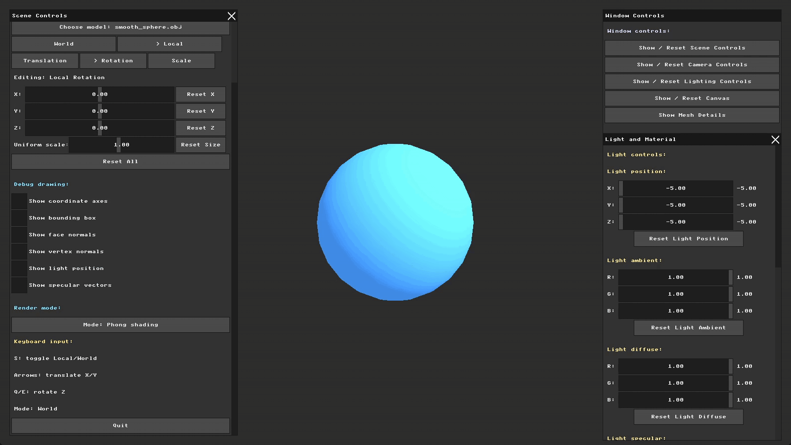
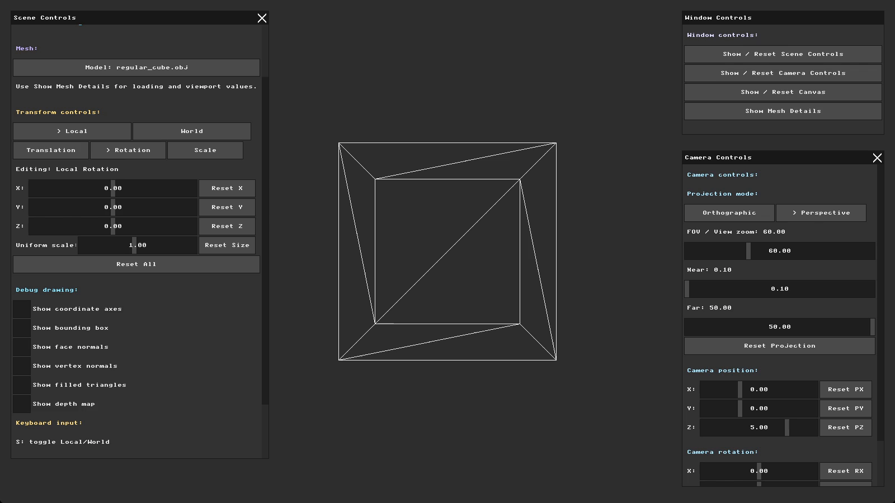

# NanoRender – A Software 3D Renderer Built from Scratch

A complete 3D rendering pipeline written in **C++**, built step by step over five assignments in the **Computer Graphics** course at the University of Haifa (2026).

Instead of relying on a graphics API, every stage is implemented by hand: drawing pixels into a framebuffer, loading 3D models, transforming and projecting them through a virtual camera, rasterizing triangles with a Z-buffer, and finally shading them with real lighting.

<p align="center">
  
  
</p>

## The Rendering Pipeline

| Stage | What I implemented | Report |
|---|---|---|
| **1. Framebuffer & GUI** | Direct pixel drawing, an immediate-mode UI, keyboard input, Bresenham line drawing, and an interactive drawing tool | [HW1](nanorender/reports/hw1_report.md) |
| **2. Wireframe Viewer** | OBJ model loading, normalization and viewport transform, orthographic projection, and translation / rotation / scale matrices with live controls | [HW2](nanorender/reports/hw2_report.md) |
| **3. Cameras & Projection** | Coordinate frames and bounding boxes, a virtual camera (view matrix), perspective projection, and face and vertex normals | [HW3](nanorender/reports/hw3_report.md) |
| **4. Rasterization** | Bounding-box rasterization, triangle filling, and the Z-buffer algorithm for correct visibility | [HW4](nanorender/reports/hw4_report.md) |
| **5. Lighting & Shading** | Light sources and materials, ambient lighting, flat (diffuse) shading, specular highlights, and per-pixel Phong shading | [HW5](nanorender/reports/hw5_report.md) |

Each report documents what was required, how I implemented it, and the visual results, with screenshots and GIFs for every step.

## Tech Stack

- **C++** with **GLM** for vector and matrix math
- **MiniFB** for the framebuffer window and **MicroUI** for the immediate-mode GUI
- **CMake** and **Ninja** for building

## Building and Running (Windows)

Requires Visual Studio Build Tools (C++), CMake and Ninja. Full setup instructions are in [`nanorender/README.md`](nanorender/README.md).

```powershell
cd nanorender
powershell -ExecutionPolicy Bypass -File .\build_and_run.ps1
```

## Repository Structure

```
nanorender/
├── src/        renderer source code
├── assets/     3D models, plus the screenshots and GIFs used in the reports
└── reports/    one detailed report per assignment
assignments/    the original assignment instructions
```

---

Developed by **Hala Ishan** as part of the Computer Graphics course, University of Haifa.
See also: [Procedural Material Lab](https://github.com/HalaIshan/procedural_material_lab), my final project for the same course.
