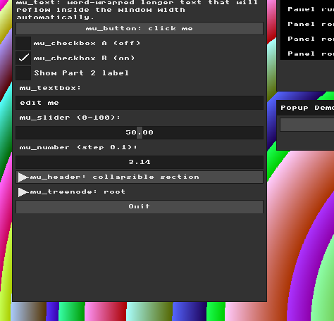
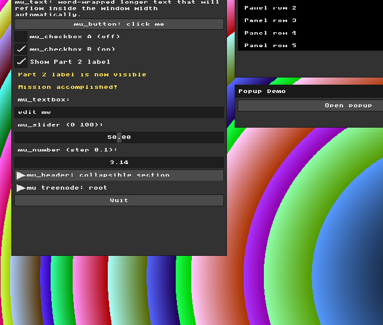

# Assignment 1 Report: Basic Graphics and Immediate Mode GUI

**Name:** Hala Ishan  
**Student ID:** 213692296  

---

## Part 1: Manipulating the Framebuffer

### What was required

Modify the background rendering loop in `main.cpp` by writing new mathematical expressions for `r`, `g`, and `b`.  
The result must be a visible 2D pattern that uses both `x` and `y`, not a solid color and not a simple horizontal or vertical strip.

### What I did

I replaced the original gradient background with a concentric circles pattern.  
For each pixel, I used its position relative to the center of the window:

```cpp
int center_x = WIDTH / 2;
int center_y = HEIGHT / 2;

int dx = x - center_x;
int dy = y - center_y;

int distance_squared = dx * dx + dy * dy;
```

Then I used `distance_squared` to calculate the RGB values:

```cpp
uint8_t r = (uint8_t)((distance_squared / 900) % 256);
uint8_t g = (uint8_t)((distance_squared / 500) % 256);
uint8_t b = (uint8_t)((distance_squared / 300) % 256);

g_buffer[i] = MFB_RGB(r, g, b);
```

Because `distance_squared` depends on both `x` and `y`, the background becomes a 2D circular pattern centered in the window.

### Result

<table>
  <tr>
    <td align="center"><b>Before</b></td>
    <td align="center"><b>After</b></td>
  </tr>
  <tr>
    <td></td>
    <td></td>
  </tr>
</table>

---

## Part 2: Immediate Mode UI Declaration

In this part, I added a new interactive MicroUI widget inside the `Widgets` window.

I added a checkbox that controls an external state variable:

```cpp
static int show_part2_label = 0;
```

Inside the UI window, the checkbox updates this variable:

```cpp
mu_layout_row(ctx, 1, w1, 0);
mu_checkbox(ctx, "Show Part 2 label", &show_part2_label);
```

When the checkbox is enabled, a custom label appears in the window:

```cpp
if (show_part2_label) {
  mu_Color old_text_color = ctx->style->colors[MU_COLOR_TEXT];
  ctx->style->colors[MU_COLOR_TEXT] = mu_color(255, 220, 80, 255);

  mu_layout_row(ctx, 1, w1, 0);
  mu_label(ctx, "Part 2 label is now visible");

  mu_layout_row(ctx, 1, w1, 0);
  mu_label(ctx, "mission accomplished!");

  ctx->style->colors[MU_COLOR_TEXT] = old_text_color;
}
```

This demonstrates Immediate Mode UI because the widget is declared every frame, while its state is stored in an external application variable.

**Note:** During testing, I noticed that the clickable area of some widgets did not perfectly match their visual position on the screen. The widget still works, but the click position is slightly offset. I kept this observation for the later renderer/input architecture part.

### Result

<table>
  <tr>
    <td align="center"><b>Checkbox Off</b></td>
    <td align="center"><b>Checkbox On</b></td>
  </tr>
  <tr>
    <td></td>
    <td></td>
  </tr>
</table>

**Implementation note:**  
I used the `colored_label` helper function for the custom Part 3 label. This keeps the code cleaner because the helper temporarily changes the text color, draws the label, and restores the original text color afterward. I later reused the same helper for the Part 2 instruction labels.

---

## Part 3: The Real-Time Graphics Loop and Input Handling

For this part, I intercepted the keyboard input pipeline to create custom visual effects while the application is running.

The program already runs inside a real-time event loop, where the framebuffer is redrawn every frame. I used the character input callback, `mfb_set_char_input_callback`, to catch specific key presses before they are passed to the normal UI text input.

I added two keyboard shortcuts:

- Pressing `P` switches the background between the concentric circles pattern from Part 1 and a checkerboard pattern.
- Pressing `I` toggles color inversion for the current background pattern.

To control these effects, I added two application state variables:

```cpp
static bool g_checkerboard_mode = false;
static bool g_invert_colors = false;
```

Inside the callback, the shortcut keys update these variables:

```cpp
if (c == 'p' || c == 'P') {
  g_checkerboard_mode = !g_checkerboard_mode;
  return;
}

if (c == 'i' || c == 'I') {
  g_invert_colors = !g_invert_colors;
  return;
}
```

I used `return` after handling these keys because they are application shortcuts. This means that `P` and `I` are consumed by the application and are not passed to the regular UI text input. All other characters still continue normally to `ui_bridge_char_input`, so the existing UI widgets can keep working.

The visual change happens immediately because the rendering loop checks these state variables every frame. If `g_checkerboard_mode` is enabled, the framebuffer draws a checkerboard pattern. Otherwise, it draws the concentric circles pattern. If `g_invert_colors` is enabled, the final RGB values are inverted before writing the pixel to the framebuffer.

### Demo


### Note

I also added a short instruction label inside the UI window so the user can understand the available keyboard controls directly from the application.

