# Assignment 1 Report: Basic Graphics and Immediate Mode GUI

**Name:** Hala Ishan  
**Student ID:** 213692296  

---
---

## Part 1: Manipulating the Framebuffer

### What was required

The task was to modify the background rendering loop in `main.cpp` by writing new mathematical expressions for `r`, `g`, and `b`.

The result had to be a visible 2D pattern that uses both `x` and `y`, not a solid color or a simple one-direction pattern.

### What I did

I replaced the original background with a concentric circles pattern. 

For each pixel, I calculated its position relative to the center of the window:

```cpp
int center_x = WIDTH / 2;
int center_y = HEIGHT / 2;

int dx = x - center_x;
int dy = y - center_y;

int distance_squared = dx * dx + dy * dy;
```

Then I used `distance_squared` to calculate the RGB values:

```cpp
uint8_t r = (uint8_t)((distance_squared / 900) % 256);
uint8_t g = (uint8_t)((distance_squared / 500) % 256);
uint8_t b = (uint8_t)((distance_squared / 300) % 256);

g_buffer[i] = MFB_RGB(r, g, b);
```
Because `distance_squared` depends on both `x` and `y`, the result is a 2D circular pattern centered in the window.


### Result
<table>
  <tr>
    <td align="center"><b>Before</b></td>
    <td align="center"><b>After</b></td>
  </tr>
  <tr>
    <td>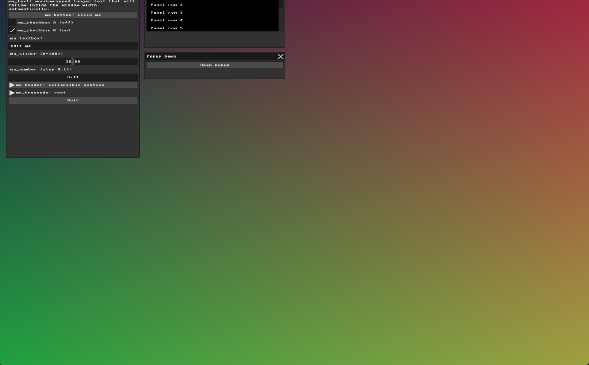</td>
    <td></td>
  </tr>
</table>

---
---

## Part 2: Immediate Mode UI Declaration

### What I did
In this part, I added a new interactive MicroUI widget inside the `Widgets` window.

I added a checkbox that controls an external state variable:

```cpp
static int show_part2_label = 0;
```

Inside the UI window, the checkbox updates this variable:

```cpp
mu_layout_row(ctx, 1, w1, 0);
mu_checkbox(ctx, "Show Part 2 label", &show_part2_label);
```

When the checkbox is enabled, a custom label appears in the window:

```cpp
if (show_part2_label) {
  mu_Color old_text_color = ctx->style->colors[MU_COLOR_TEXT];
  ctx->style->colors[MU_COLOR_TEXT] = mu_color(255, 220, 80, 255);

  mu_layout_row(ctx, 1, w1, 0);
  mu_label(ctx, "Part 2 label is now visible");

  mu_layout_row(ctx, 1, w1, 0);
  mu_label(ctx, "Mission accomplished!");

  ctx->style->colors[MU_COLOR_TEXT] = old_text_color;
}
```

This demonstrates Immediate Mode UI because the widget is declared every frame, while its state is stored in an external application variable.

**Note:** During testing, I noticed a small mismatch between the visual widget position and the clickable area. I kept this observation for the later renderer/input architecture part.

### Result

<table>
  <tr>
    <td align="center"><b>Checkbox Off</b></td>
    <td align="center"><b>Checkbox On</b></td>
  </tr>
  <tr>
    <td></td>
    <td></td>
  </tr>
</table>


**Implementation note:**  
I used a helper function called `colored_label` to temporarily change the text color, draw a label, and then restore the original text color(did it when i did part 3 then reuse it also for part 2). This kept the UI code cleaner and allowed me to reuse the same helper in later parts.

---
---

## Part 3: The Real-Time Graphics Loop and Input Handling


For this part, I intercepted the keyboard input pipeline to create custom visual effects while the application is running.

The program already runs inside a real-time event loop, where the framebuffer is redrawn every frame. I used the character input callback, `mfb_set_char_input_callback`, to catch specific key presses before they are passed to the normal UI text input.

I added two keyboard shortcuts:

- Pressing `P` switches the background between the concentric circles pattern from Part 1 and a checkerboard pattern.
- Pressing `I` toggles color inversion for the current background pattern.

To control these effects, I added two application state variables:

```cpp
static bool g_checkerboard_mode = false;
static bool g_invert_colors = false;
```

Inside the callback, the shortcut keys update these variables:

```cpp
if (c == 'p' || c == 'P') {
  g_checkerboard_mode = !g_checkerboard_mode;
  return;
}

if (c == 'i' || c == 'I') {
  g_invert_colors = !g_invert_colors;
  return;
}
```

I used `return` after handling these keys because they are application shortcuts. This consumes `P` and `I`, so they are not passed to normal text input. Other characters still continue to `ui_bridge_char_input`, so regular UI text input remains functional.

The visual change happens immediately because the rendering loop checks these state variables every frame. If `g_checkerboard_mode` is enabled, the framebuffer draws a checkerboard pattern. Otherwise, it draws the concentric circles pattern. If `g_invert_colors` is enabled, the final RGB values are inverted before writing the pixel to the framebuffer.

### Demo

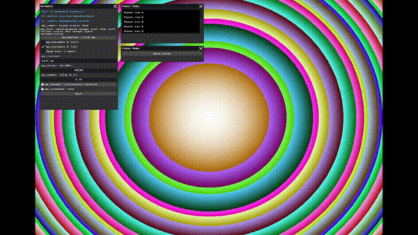

I also added a short instruction label inside the UI window so the user can understand the available keyboard controls directly from the application.

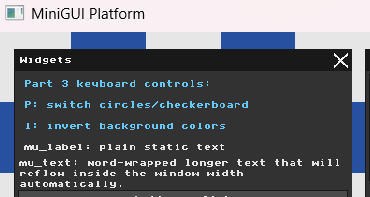


---
---

## Part 4: UI Architecture & The Renderer Bridge


### Goal and Initial Observation

The goal of this part was to understand the separation between MicroUI's logical UI system and the visual rendering layer.

At first, before applying the visual offset, I noticed a mismatch during clicking. The place where the mouse cursor appeared, the place where the click seemed to be detected, and the actual place that activated the button were not always perfectly aligned.

Because of this, I added a temporary red click marker in `main.cpp`. The goal of this marker was to make the click position visible in the recordings and make the difference easier to explain.

This marker was only a debugging and documentation tool. It is not part of MicroUI, not part of the renderer, and not part of the final UI behavior.

### Experiment 1: Original Renderer

First, I tested the original `ui_renderer.cpp`, without adding any visual offset.

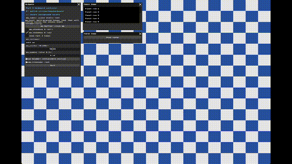

In this recording, the UI is still drawn in its original position. The red marker helped show the detected click position and made the initial mismatch easier to see.

### Renderer Code Change

After checking the original behavior, I prepared `ui_renderer.cpp` for a controlled visual-offset experiment.

I added two constants at the top of the file:

```cpp
static const int UI_VISUAL_OFFSET_X = 300;
static const int UI_VISUAL_OFFSET_Y = -100;
```

The purpose of these constants is to move only the visual drawing of the UI. This makes it easy to test different offset values without changing MicroUI itself.

Then, inside `draw_rect`, I applied the offset to the rectangle coordinates before drawing the pixels:

```cpp
rect.x += UI_VISUAL_OFFSET_X;
rect.y += UI_VISUAL_OFFSET_Y;
```

Then I applied the same visual offset in `draw_text` and `draw_icon`, so the rectangles, labels, and icons moved together as one visual UI group.


### Experiment 2: Offset Mechanism with Offset = 0

Next, I added offset variables to `ui_renderer.cpp`, but kept them at zero:

```cpp
static const int UI_VISUAL_OFFSET_X = 0;
static const int UI_VISUAL_OFFSET_Y = 0;
```


Since the offset is `(0, 0)`, the UI still appears in the same place. This confirmed that adding the offset mechanism alone does not change the rendering unless the offset values are changed.

### Experiment 3: Large Visual Offset

Finally, I changed the offset to a large value:

```cpp
static const int UI_VISUAL_OFFSET_X = 300;
static const int UI_VISUAL_OFFSET_Y = -100;
```

In `draw_rect`, I applied the offset to the rectangle coordinates:

```cpp
rect.x += UI_VISUAL_OFFSET_X;
rect.y += UI_VISUAL_OFFSET_Y;
```

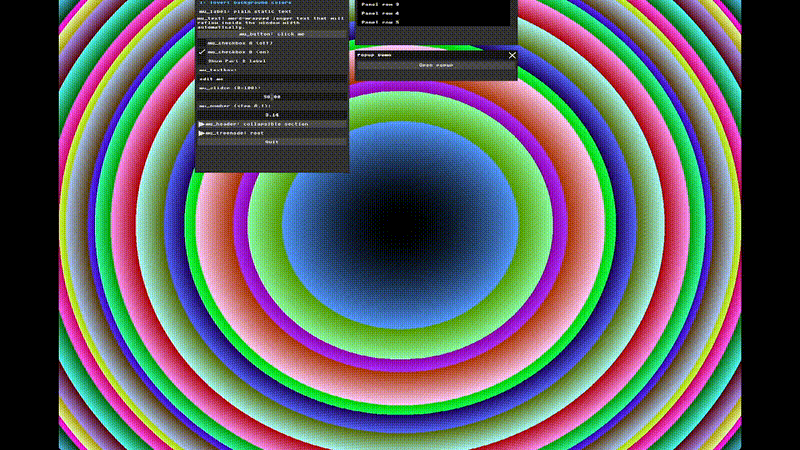

Now the UI is drawn in a clearly shifted visual position. However, the clickable area does not move with the drawing.

This happens because the offset was applied only inside `UIRenderer`. MicroUI still calculates the widget layout and hit-testing using the original coordinates.

Therefore, clicking on the shifted visual button does not necessarily activate it. The real clickable area remains near the original MicroUI position.

### Renderer Experiment Conclusion

This experiment shows that MicroUI and `UIRenderer` have different responsibilities.

MicroUI controls the UI logic, layout, and click detection. `UIRenderer` only controls what is drawn on the framebuffer.

Changing the renderer moves the visual output, but it does not automatically move the logical clickable area. This is why the shifted UI and the mouse interaction no longer match.

### Input Alignment Fix

After finishing the renderer offset experiment, I restored the visual renderer offset back to zero:

```cpp
static const int UI_VISUAL_OFFSET_X = 0;
static const int UI_VISUAL_OFFSET_Y = 0;
```

This returned the UI rectangles, text, and icons to their normal visual positions.

During the earlier tests, I had already noticed that there was still an input mismatch that was not fixed by changing the renderer. After restoring the visual offset to zero, I understood that this remaining problem needed to be corrected from the input side in `main.cpp`, not from `ui_renderer.cpp`.

To fix this, I added a small input correction in `main.cpp` after reading the input:

```cpp
static const int UI_INPUT_OFFSET_Y = 35;
ctx->mouse_pos.y += UI_INPUT_OFFSET_Y;
```

This adjustment moves the mouse input coordinate vertically before MicroUI uses it for hit-testing. After testing different values, `35` gave the best alignment between the visible button and the actual clickable area.

The temporary red click marker was removed/disabled after this fix, because it was only needed for debugging and recording the earlier experiments.

The following demo shows the corrected behavior without the red debug marker:

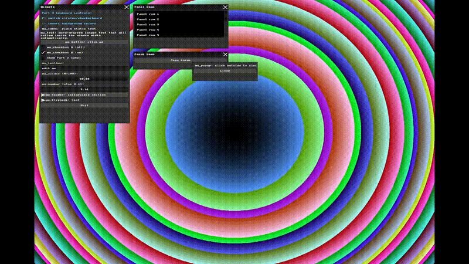

This final test shows that the UI is visually back in its normal position, and the clickable area is now better aligned with the visible button.


### Final Input Alignment Update

After more testing, I discovered that the remaining input alignment problem was related to the application window size.

The window was larger than my laptop screen, so part of it was not comfortably visible during testing. This made the visible UI position and the mouse interaction feel misaligned.

After resizing the application window and adjusting the UI layout, the old Y-axis offsets were no longer needed.

I set both the UI input offset and the line drawing offset back to `0`. After this change, the mouse position matched the visible UI controls correctly.

This showed me that input issues can sometimes come from the testing environment and window size, not only from the renderer or the UI logic.


---
---

## Part 5: Binding UI to Application State


### Goal

The goal of this part was to bind new MicroUI controls to application state variables, and use those variables to change the background rendering in real time.

### Idea

For this part, I decided to make the background pattern controllable from the UI itself.

Until now, the background could be changed using keyboard shortcuts from Part 3. In this part, I added new controls inside the MicroUI window so the user can change the background directly with sliders and a checkbox.

I chose three controls:

- A slider for the checkerboard tile size.
- A slider for the circle color intensity.
- A checkbox for enabling background animation.

### Code Changes

I added new application state variables in `main.cpp`:

```cpp
static float part5_tile_size = 80.0f;
static float part5_color_intensity = 1.0f;
static int part5_animate_background = 0;
static int frame_counter = 0;
```

Then I added new UI controls inside the MicroUI window:

```cpp
mu_slider(ctx, &part5_tile_size, 20, 160);
mu_slider(ctx, &part5_color_intensity, 0.2f, 2.0f);
mu_checkbox(ctx, "Animate background", &part5_animate_background);
```

Finally, I used these variables inside the background rendering loop:

* `part5_tile_size` changes the checkerboard tile size.
* `part5_color_intensity` changes the intensity of the concentric circle colors.
* `part5_animate_background` enables a simple animation effect using `frame_counter`.

The existing keyboard controls from Part 3 still work:

* `P` switches between circles and checkerboard.
* `I` inverts the background colors.

### Result

The following table summarizes the new UI controls and how each one affects the background rendering loop.

| UI control | Application state variable | Effect on background | Demo |
|---|---|---|---|
| Tile size slider | `part5_tile_size` | Changes the checkerboard square size. | 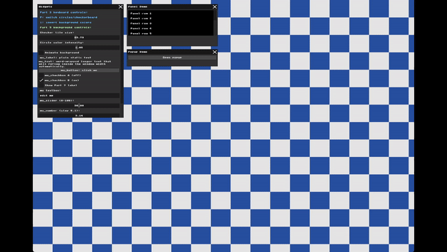 |
| Color intensity slider | `part5_color_intensity` | Changes the strength of the concentric circle colors. | 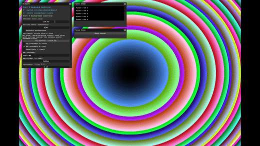 |
| Animate background checkbox | `part5_animate_background` + `frame_counter` | Animates the concentric circle colors over time. | 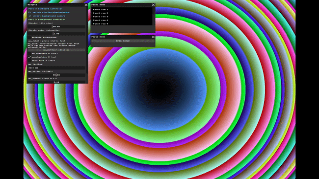 |
| Animate background checkbox | `part5_animate_background` + `frame_counter` | Moves the checkerboard pattern over time. | 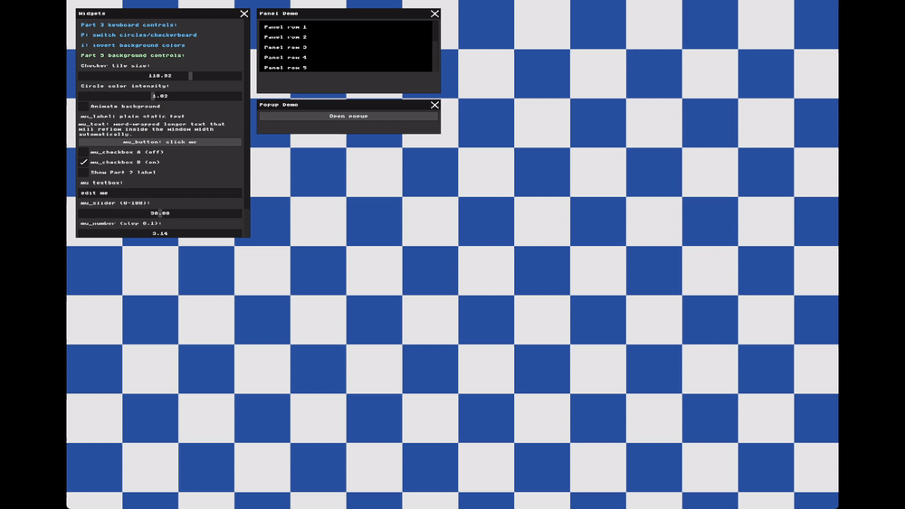 |

These results show that the new MicroUI widgets directly update application state variables, and the background rendering loop uses the updated values immediately in the next frame.

---

---

## Part 6: Interactive Line Drawing App

### 6.1 Write the Line Function

#### Goal

The goal of this step was to implement a Bresenham line drawing function that draws a line between two points directly on `g_buffer`.

#### What I did

I added a helper function called `draw_pixel`.  
It checks that the pixel is inside the window boundaries, and then writes the color to the correct 1D index in the framebuffer.

```cpp
static void draw_pixel(int x, int y, uint32_t color) {
  if (x < 0 || x >= WIDTH || y < 0 || y >= HEIGHT) {
    return;
  }

  g_buffer[y * WIDTH + x] = color;
}
```

Then I added the `draw_line` function.  
It uses integer calculations and supports different slopes and directions without writing a separate case for each one.

```cpp
static void draw_line(int x0, int y0, int x1, int y1, uint32_t color) {
  int dx = abs(x1 - x0);
  int sx = x0 < x1 ? 1 : -1;

  int dy = -abs(y1 - y0);
  int sy = y0 < y1 ? 1 : -1;

  int error = dx + dy;

  while (true) {
    draw_pixel(x0, y0, color);

    if (x0 == x1 && y0 == y1) {
      break;
    }

    int e2 = 2 * error;

    if (e2 >= dy) {
      error += dy;
      x0 += sx;
    }

    if (e2 <= dx) {
      error += dx;
      y0 += sy;
    }
  }
}
```

#### Testing

To test the function, I added temporary hardcoded lines after drawing the background and before rendering the UI.  
I used six examples to check different cases: horizontal, vertical, shallow slope, steep slope, reverse direction, and reverse diagonal.

For example:

```cpp
draw_line(520, 420, 1120, 420, MFB_RGB(255, 255, 255)); // horizontal line
draw_line(600, 1000, 850, 480, MFB_RGB(255, 255, 0));   // steep slope line
```

#### Result

The test lines appeared correctly on top of the background.  
This shows that the function works for different slopes and directions.

The diagonal lines look slightly stair-stepped because the screen is a discrete pixel grid, which is expected in raster line drawing.

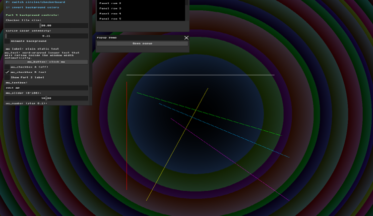


---

### 6.2 AI-Assisted UX Planning

#### Goal

The goal of this step was to use AI assistance to plan the mouse interaction for the line drawing tool before implementing it in code.

#### Idea

Before writing the code, I used an AI assistant to compare different ways a user could draw a line with the mouse.

The options I considered were:

| Approach | Pros | Cons | State logic |
|---|---|---|---|
| Two clicks | Easy to understand. The user clicks start and then clicks end. | The program must remember the first click. The user may not know that the program is waiting for the second click. | Save the first point. On the second click, save the final line. |
| Drag and release | Feels natural for drawing. The user can see the line while dragging. | Needs temporary state while the mouse is held. The preview line should not be saved every frame. | On press, save the start point. While dragging, update the preview. On release, save the line. |
| Click, preview, click | The user can preview the line without holding the mouse button. | More complex. The program stays in drawing mode between two clicks. | Save the first point, show preview while moving, and save the line on the second click. |

I chose the drag and release approach.

The interaction works like this:

- Press the left mouse button to start the line.
- Drag the mouse to preview the line.
- Release the mouse button to save the final line.

I chose this approach because it is simple, direct, and gives immediate visual feedback while drawing.

#### Code Changes

I implemented the drag-and-release interaction by separating the drawing process into two parts: temporary preview and saved lines.

When the user presses the left mouse button, the program saves the start point.  
While the user drags the mouse, the program updates the end point and shows a yellow preview line.  
When the user releases the mouse button, the line is saved as a final line.

The saved lines are redrawn every frame after the background is rendered, because the framebuffer is refreshed each frame.

I also limited drawing to the empty area outside the UI window, so clicking on UI controls does not accidentally create lines.

In the final behavior, the preview line appears in yellow while dragging, and the saved lines appear in white after release.

#### Input Calibration Note

During testing, I noticed that the drawn line did not fully match the visible mouse position.  
The line appeared slightly above the cursor.

This happened because I already added an input correction in Part 4 for MicroUI click alignment.  
That correction helped the UI buttons, but the line drawing uses the mouse position to draw directly on `g_buffer`, so it still needed a separate small adjustment.

For this reason, I added another vertical offset only for the line drawing input.

This offset is not part of Bresenham's algorithm.  
It is only used to align the drawn line with the visible mouse position.

#### Result

The application now supports interactive line drawing with the mouse.

While dragging, the application shows a yellow preview line.  
After releasing the mouse button, the line becomes permanent and is redrawn in white every frame.

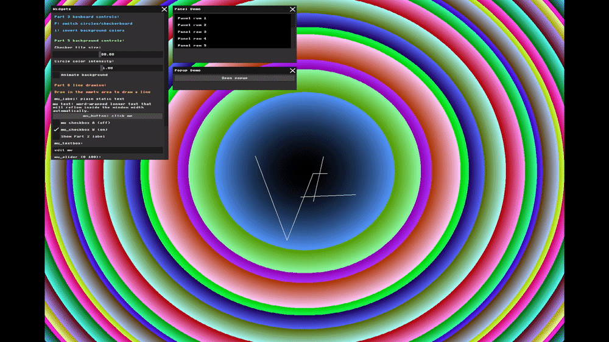

---

### 6.3 The Creative Canvas

#### Goal

The goal of this final step was to combine the previous parts into a more useful interactive drawing tool.

#### Idea

For the creative canvas, I extended the line drawing tool from Part 6.2.

Instead of drawing all lines with one fixed color, I added UI controls that allow the user to choose the current line color.  
I also added a clear button so the user can remove all saved lines from the canvas.

The final tool includes:

- RGB sliders for controlling the current line color.
- A live preview line using the selected color.
- Permanent saved lines.
- A `Clear canvas` button.

#### Code Changes

I added three UI sliders for the red, green, and blue values of the current line color.

These values are used when drawing the temporary preview line and also when saving the final line.  
This means the user can choose a color, draw a line, then change the color and draw another line.

I also added a `Clear canvas` button.  
When the button is clicked, the list of saved lines is cleared, and the canvas becomes empty again.

To keep the interface cleaner, I placed the Creative Canvas controls in their own separate window.  
This made the drawing controls easier to use and separated them from the older widgets window.

#### Result

The final version works as an interactive creative canvas.

The user can draw multiple permanent lines, choose different colors using the RGB sliders, and clear the canvas when needed.

The following image shows lines drawn with different selected colors:

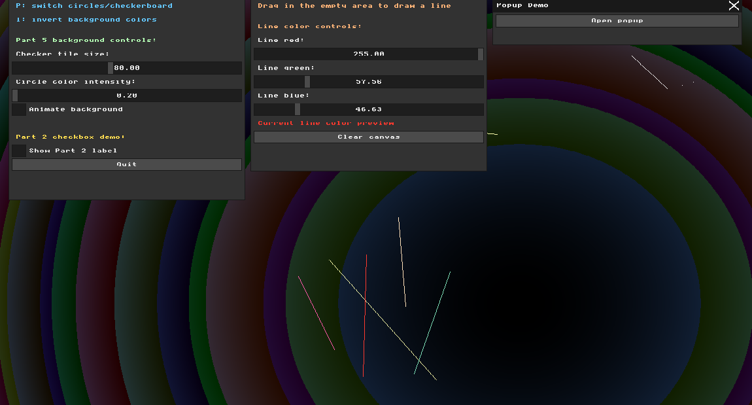

The following demo shows the line color changing using the RGB sliders:

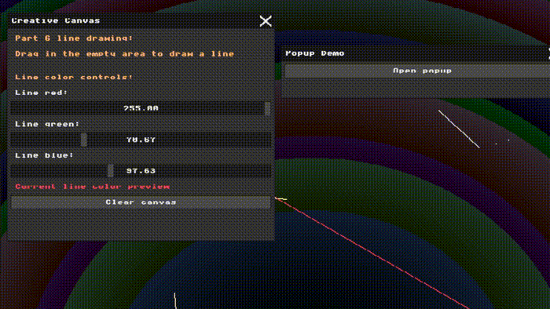

The following demo shows the clear canvas button removing the saved lines:


---
---

## Development Notes

During this assignment, the main challenge was understanding how input, UI layout, and rendering work together, not only drawing graphics.

At first, I noticed that the visible UI controls and the clickable areas did not always match perfectly. In Part 4, I tested this using a temporary click marker and renderer visual offsets.

This helped me understand that MicroUI handles layout and input hit-testing, while `UIRenderer` only draws the UI on the framebuffer. Therefore, moving the UI visually in the renderer does not move the logical clickable area.

Later, I found that part of the issue was also related to my testing setup. The application window was too large for my laptop screen, which made the UI feel misaligned during interaction.

After resizing the application window and adjusting the UI layout, the old Y-axis offsets were no longer needed. I set both the UI input offset and the line drawing offset back to `0`, and the mouse position matched the UI controls correctly.

This showed me that input problems can come from several sources, including the renderer, UI logic, input mapping, and even the window size used during testing.

---
---

## Additional UI Cleanup and Usability Improvements

After finishing the main Assignment 1 features, I returned to the interface and made several cleanup improvements.

These changes are not a new drawing algorithm, but they make the creative canvas easier to use and prepare the interface for continued work.

In hindsight, it would have been better to make these UI cleanup improvements gradually during each part of the assignment. However, while working under time pressure and focusing on completing the required features first, I left some usability issues to fix later. Returning to them at the end helped me make the final interface cleaner and easier to continue working with.

### What I improved

- I adjusted the application window size so it opens in a more comfortable size on my screen.

- I adjusted the UI row height, padding, and spacing so the text appears clearly and is not clipped.

- After fixing the window size and layout, I rechecked the mouse alignment and removed the old Y-axis offsets. Both the UI input offset and the line drawing offset are now set to `0`.

- I allowed line drawing across the full background instead of limiting it to only one fixed drawing area.

- I replaced the old unused Popup Demo with a useful `Window Controls` panel. Because the main UI windows can take space from the drawing area, I wanted to be able to close them when they are not needed and restore them later. The `Window Controls` panel stays available, cannot be accidentally closed, remains movable, and provides buttons for showing and resetting the `Widgets` window and the `Creative Canvas` window to their original positions.

- I made the background controls more context-aware. When the current background is the circles pattern, the UI shows the `Circle color intensity` slider. When the current background is the checkerboard pattern, the UI shows the `Checker tile size` slider. The animation checkbox remains available because it affects both background modes.

- The slider values are not reset when switching between background modes. This keeps the last selected values saved and makes the controls feel more consistent.

- I prevented line drawing from starting when the first mouse press happens on top of a UI window. If the line starts on the background, the user can still drag the line across UI windows normally. This keeps the drawing behavior natural while preventing accidental lines when interacting with the UI.

- I kept the `Window Controls` panel inside the visible logical application area. This makes sure that the always-available control panel remains reachable even after dragging it near the window edges.

- I applied this boundary restriction only to the `Window Controls` panel. The `Widgets` and `Creative Canvas` windows can still be moved freely because they can be restored using the buttons inside `Window Controls`.


### Result

The cleanup changes made the interface easier to use and reduced accidental interactions while drawing.

The following demos summarize the final behavior after the improvements.

<table>
  <tr>
    <td align="center"><b>Window controls</b></td>
    <td align="center"><b>Context-aware background controls</b></td>
  </tr>
  <tr>
    <td>
      This demo shows that the main control windows can be closed, moved, and restored using the `Window Controls` panel.
    </td>
    <td>
      This demo shows that the visible background slider changes according to the active background mode.
      In circles mode, the UI shows `Circle color intensity`.
      In checkerboard mode, the UI shows `Checker tile size`.
    </td>
  </tr>
  <tr>
    <td>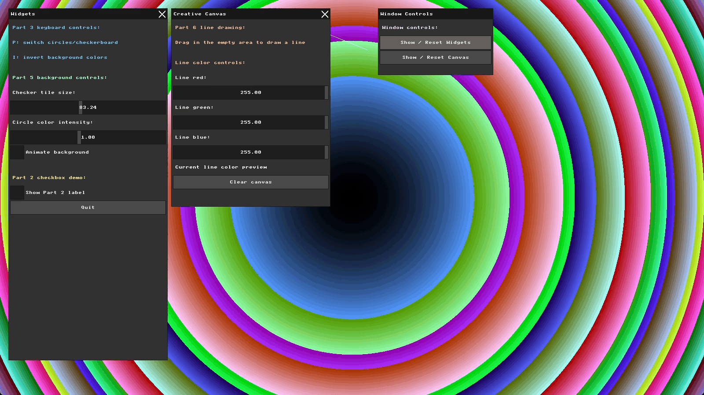</td>
    <td>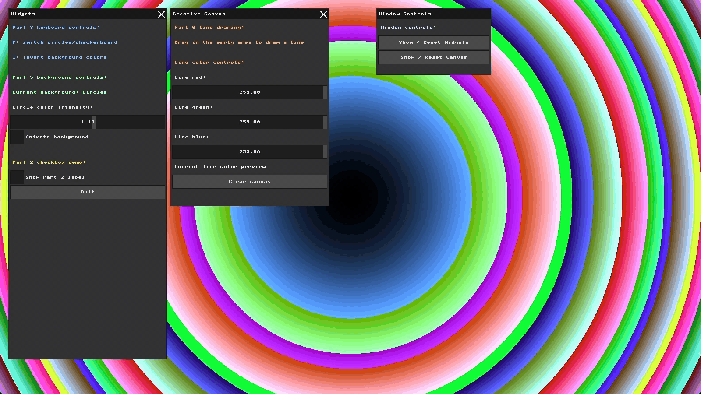</td>
  </tr>
</table>

<table>
  <tr>
    <td align="center"><b>Before line drawing fix</b></td>
    <td align="center"><b>After line drawing fix</b></td>
  </tr>
  <tr>
    <td>
      Before the fix, starting a drag on top of a UI window could accidentally create a line.
    </td>
    <td>
      After the fix, drawing only starts if the first mouse press begins on the background.
      If the line already started on the background, it can still pass over UI windows while dragging.
    </td>
  </tr>
  <tr>
    <td>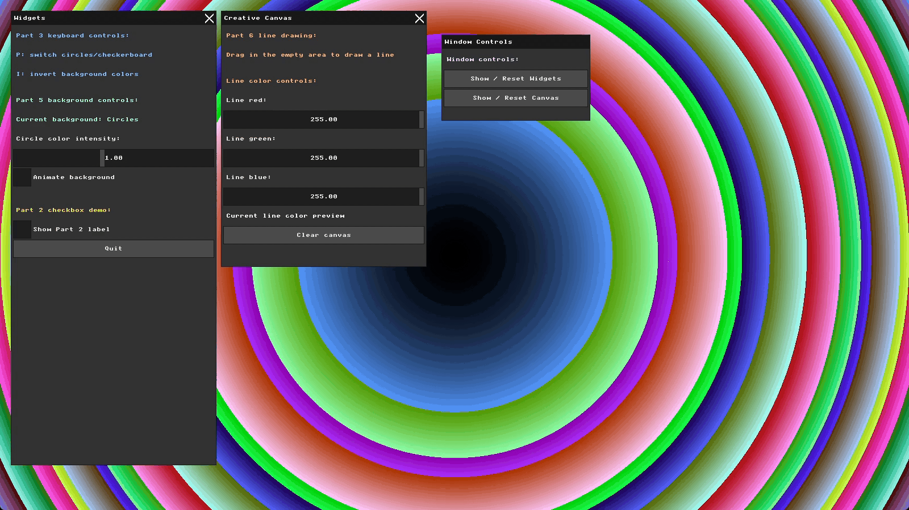</td>
    <td>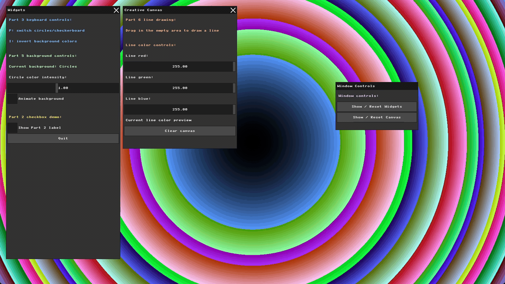</td>
  </tr>
</table>

<table>
  <tr>
    <td align="center"><b>Before Window Controls boundary fix</b></td>
    <td align="center"><b>After Window Controls boundary fix</b></td>
  </tr>
  <tr>
    <td>
      Before the fix, the <code>Window Controls</code> panel could be dragged outside the visible application area.
    </td>
    <td>
      After the fix, the panel remains inside the visible logical application area, so it stays reachable.
    </td>
  </tr>
  <tr>
    <td>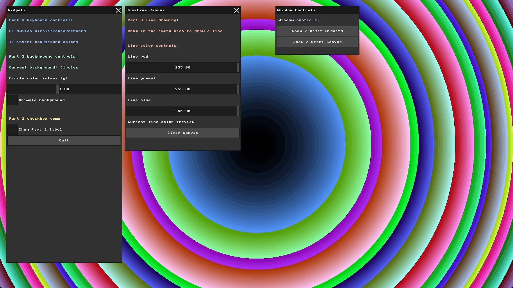</td>
    <td>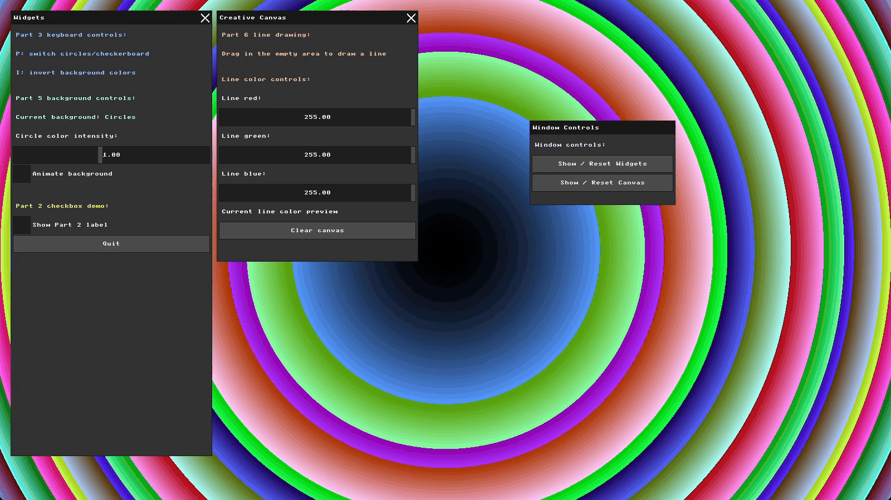</td>
  </tr>
</table>


## Final note and future direction

These cleanup changes made the Assignment 1 interface more usable and gave me a clearer base before continuing with the next assignment.

This final cleanup also helped me understand that usability issues are part of graphics programming, not only visual output. I learned that small interaction details, such as window placement, input boundaries, and accidental clicks, can strongly affect how comfortable the application feels to use.

For this cleanup, I kept the `Window Controls` boundary check based on the fixed logical application size, which is `1600 × 900`.

I did not implement full dynamic window resizing because the framebuffer, renderer, drawing bounds, and display update call are all currently based on the fixed `WIDTH` and `HEIGHT` values.

Supporting true dynamic resizing would require a larger refactor, such as using a dynamic framebuffer, updating the renderer dimensions, changing drawing bounds, and checking input-coordinate mapping after resizing.

I also noticed that if future assignments add more UI windows, screen space may become harder to manage. For the current version, I kept the windows open by default because this is simpler and more useful while the number of windows is still small. If later assignments require more windows or more groups of controls, I can organize them into separate panels and use the `Window Controls` panel to show or reset only the needed group.