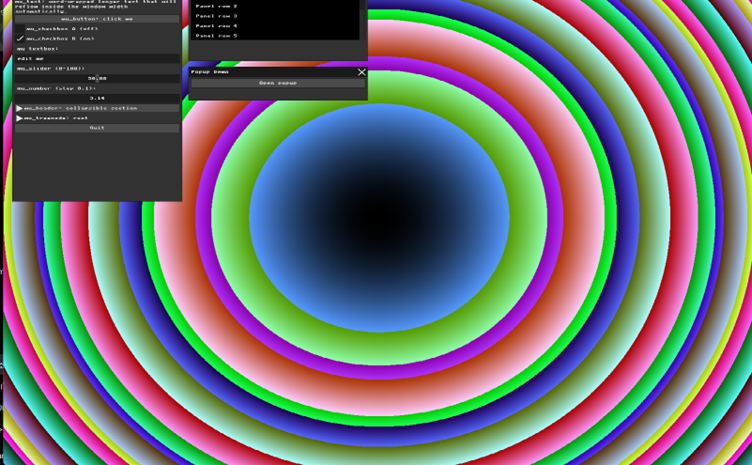

# Assignment 1 Report: Basic Graphics and Immediate Mode GUI

**Name:** Hala Ishan  
**Student ID:** 213692296  

---

## Part 1: Manipulating the Framebuffer

### What was required

Modify the background rendering loop in `main.cpp` by writing new mathematical expressions for `r`, `g`, and `b`.  
The result must be a visible 2D pattern that uses both `x` and `y`, not a solid color and not a simple horizontal or vertical strip.

### What I did

I replaced the original gradient background with a concentric circles pattern.  
For each pixel, I used its position relative to the center of the window:

```cpp
int center_x = WIDTH / 2;
int center_y = HEIGHT / 2;

int dx = x - center_x;
int dy = y - center_y;

int distance_squared = dx * dx + dy * dy;
```

Then I used `distance_squared` to calculate the RGB values:

```cpp
uint8_t r = (uint8_t)((distance_squared / 900) % 256);
uint8_t g = (uint8_t)((distance_squared / 500) % 256);
uint8_t b = (uint8_t)((distance_squared / 300) % 256);

g_buffer[i] = MFB_RGB(r, g, b);
```

Because `distance_squared` depends on both `x` and `y`, the background becomes a 2D circular pattern centered in the window.

### Result

<table>
  <tr>
    <td align="center"><b>Before</b></td>
    <td align="center"><b>After</b></td>
  </tr>
  <tr>
    <td></td>
    <td></td>
  </tr>
</table>