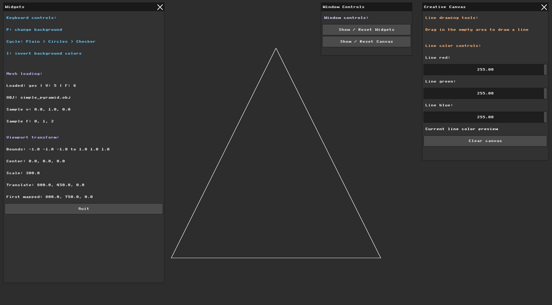
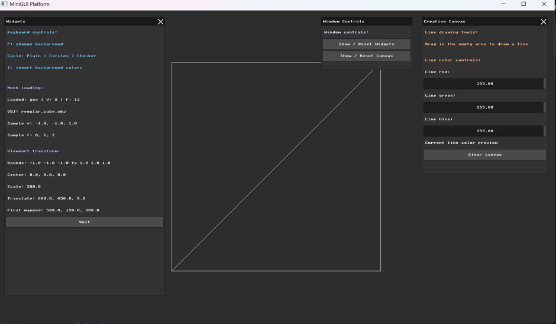
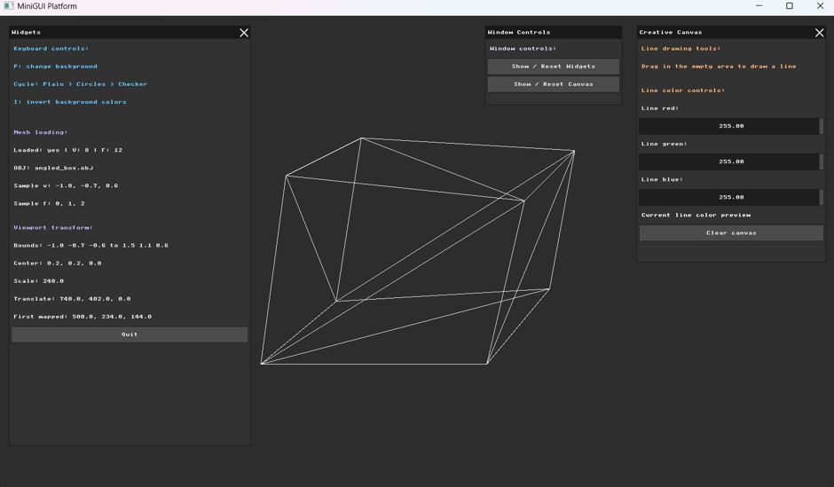
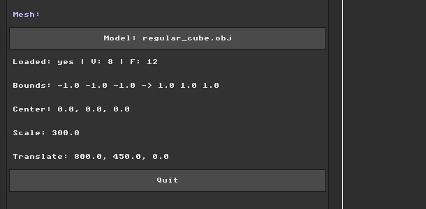
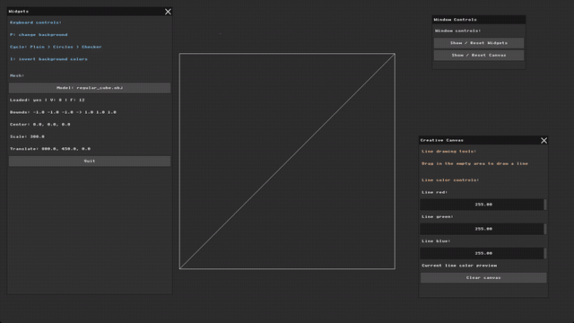
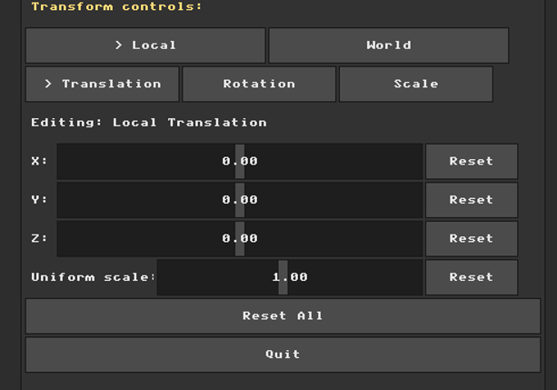
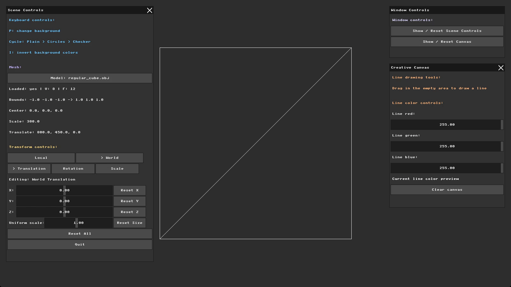
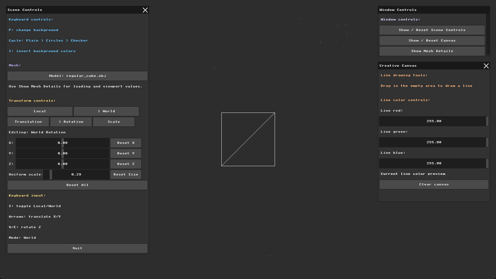
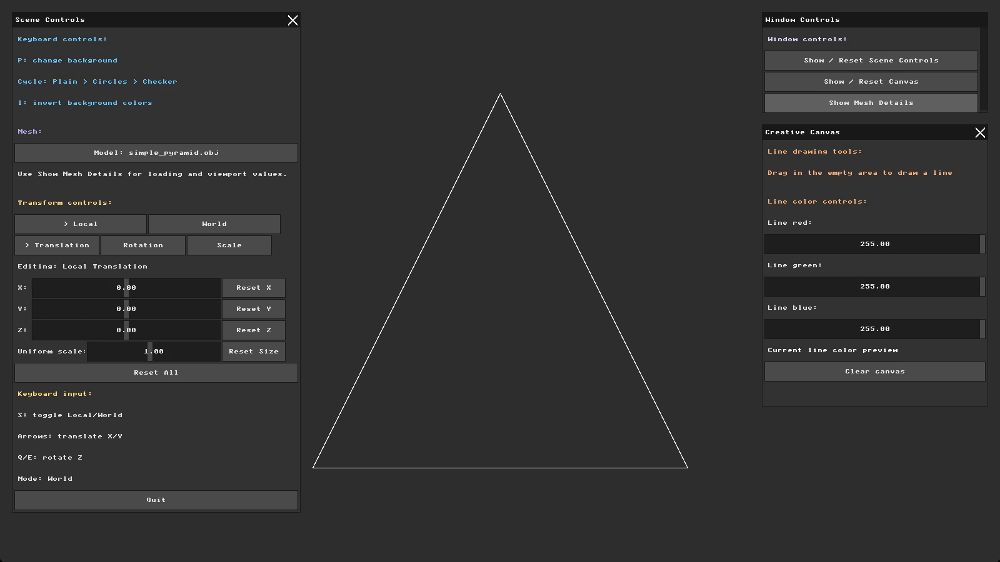

# Assignment 2 Report: Wireframe Viewer and Geometric Transformations

**Name:** Hala Ishan  
**Student ID:** 213692296

---

## Part 0: Introduction to GLM

I integrated GLM to provide the 3D vectors and matrices needed for translation, rotation, and scaling.

I updated the project configuration so that CMake fetches and links GLM with the application, then included it in `main.cpp`. I added a small test to verify that GLM vectors and transformation matrices work correctly in the running project.

I tested a translation of `+10.0` on the X axis of the point `(1.0, 2.0, 3.0)`. The result was `(11.0, 2.0, 3.0)`, confirming that only X changed while Y and Z remained unchanged.

I initially displayed this result in the GUI to confirm that GLM was working. I later removed the temporary test when GLM became part of the actual mesh calculations.

### Development Note

While testing Part 0, I rechecked the mouse alignment after resizing the application window and adjusting the UI layout. I found that the earlier mismatch was partly caused by the window being too large for my screen, so the old UI and line-drawing Y-axis offsets were no longer needed. After removing them, the mouse input aligned correctly with the visible controls. This led me to revisit Assignment 1 and make several UI improvements, including replacing the unused popup with the `Window Controls` panel and displaying only the controls relevant to the active background. The full Assignment 1 implementation and improvements are documented in its report, allowing this report to remain focused on GLM, the Assignment 2 requirements, and related work.

---

## Part 1: Loading and Inspecting 3D Data

In this part, I loaded a simple `.obj` mesh file and stored its data in memory.  
For testing, I created `simple_pyramid.obj`, a small square pyramid with 5 vertices and 6 triangular faces.

In `main.cpp`, I added a `Mesh` structure that stores vertices as `glm::vec3` values and triangular faces as three vertex indices.  
The OBJ loader reads the file line by line, storing `v` lines as vertices and `f` lines as faces.  
Because OBJ uses 1-based indices while C++ vectors use 0-based indices, I subtract 1 from each face index before storing it.

To verify the loader, I displayed the mesh information in the GUI:

The file loaded with 5 vertices and 6 faces, matching the `.obj` file.  
The first face appears as `0, 1, 2` because the OBJ indices `1, 2, 3` were converted to C++ vector indexing.

---

## Code Organization Note

After Part 1, I reviewed the code based on the code-session comments and the recommendation to apply the DRY principle.  
We discussed different ways to organize a source file, such as grouping global parameters near the top or keeping them close to the functions that use them. Although neither approach is always better, I decided that grouping related code would make the growing file easier to follow.  
Without changing the program's behavior, I removed unused demo and debug code, grouped related variables, moved repeated UI code into helper functions, and centralized values such as window titles, UI colors, default positions, and OBJ paths.  
After the cleanup, I rebuilt and tested the project to confirm that OBJ loading and the viewport information still worked correctly.

---

## Part 2: Normalization and the Viewport Transform

I added a temporary viewport transform that fits the loaded mesh inside the framebuffer, even when its original `.obj` coordinates are very small, very large, or not centered.

The transformation is calculated in five steps:

1. **Bounding box:** I check every vertex to find the minimum and maximum `x`, `y`, and `z` values. These values describe the full range occupied by the mesh.

2. **Mesh center:** I calculate the midpoint of the bounding box using `center = (min + max) / 2`.

3. **Uniform scale:** I calculate the bounding-box dimensions using `size = max - min`, then select the largest dimension with `max_extent = max(size.x, size.y, size.z)`. I use `scale = 600 / max_extent`, where `600` is the target mesh size in pixels. Using the same scale on every axis keeps the original proportions and leaves space around the model.

4. **Translation:** I move the scaled mesh center to the framebuffer center using `translation = framebuffer_center - center * scale`.

5. **Final mapping:** I transform each original vertex using `mapped_position = original_position * scale + translation`.

To verify the calculations, I displayed the bounding box, center, scale, translation, and first mapped vertex in the GUI. At this stage, the transform only prepared the normalized screen coordinates; wireframe rendering was added in Part 3.

For the square pyramid model, the bounding box is from `-1` to `1` on each axis. This gives a center of `(0, 0, 0)`, a scale of `300`, and a translation of `(800, 450, 0)`, which places the normalized model around the center of the framebuffer.

---

## Prework Before Part 3

Before Part 3, I added a plain gray background to make the wireframe easier to see. The darker inverted shade is the default because it shows both light and dark drawing colors clearly, while `I` switches to the lighter shade.

The `P` key cycles through:

`Plain -> Circles -> Checkerboard`

Plain mode hides the unused tile-size, color-intensity, and animation controls. The relevant controls reappear when circles or checkerboard is selected.

---

## Part 3: Orthographic Projection and Wireframe Rendering

### Orthographic Projection

After applying the Part 2 viewport transform, I orthographically project each vertex into 2D by keeping `x` and `y` and dropping `z`. Because screen `y` increases downward, I flip it only in the Part 3 projection helper:

`screen_x = mapped_x`  
`screen_y = (HEIGHT - 1) - mapped_y`

### Wireframe Rendering

For each triangular face, I retrieve and project its three vertices, then use the Assignment 1 `draw_line` function to draw the edges `v0 -> v1`, `v1 -> v2`, and `v2 -> v0`. This creates a static wireframe of the loaded OBJ mesh above the plain background.

### Testing Different Models

I tested the same renderer with three models to compare how their geometry appears after dropping `z`:

<table>
  <tr>
    <th>Simple pyramid</th>
    <th>Regular cube</th>
    <th>Angled box</th>
  </tr>
  <tr>
    <td></td>
    <td></td>
    <td></td>
  </tr>
</table>

The pyramid looks like a triangle because its depth is lost. The cube's front and back faces overlap because they share the same `x` and `y` coordinates. The angled box is clearest because its shifted back face keeps visible depth after projection. The diagonal lines come from the triangular OBJ faces.

I kept the regular cube as the default because it clearly shows this projection limitation before Part 4.

### Viewer Organization Improvement

After Part 3, I combined the Part 1 loading information and Part 2 viewport values into one compact `Mesh` section.  
I removed the no-longer-needed sample vertex and face, but kept the load status, vertex and face counts, bounds, center, scale, and translation.  
I also added a model selector, making the panel clearer and leaving space for upcoming controls.

### Interactive Model Selection Demo

The models are stored in `nanorender/assets/hw2/models/` and defined in the `MESH_OPTIONS` list. The following demo shows the selector changing the model and immediately updating its information and wireframe:

Later, while starting Assignment 3, I moved the reusable OBJ models to the shared folder `nanorender/assets/models/` and updated the renderer to load them from there.

---

## Part 4: Transformation Matrices and Immediate Mode GUI

For Part 4, I added an Immediate Mode GUI for editing transformation parameters. The controls include Local and World values for translation, rotation, and scale on the X, Y, and Z axes.

The first selector chooses the transformation space: `Local` or `World`. The second selector chooses the operation: `Translation`, `Rotation`, or `Scale`. The `Editing` label shows the active choice, and switching between options keeps the previous values saved.

Each selected operation has X, Y, and Z sliders with a Reset button beside each one. Translation and rotation reset to `0`, while scale resets to `1`. I also added `Reset All` for every transform value and a `Uniform scale` slider to resize the whole model while keeping its proportions.

The slider ranges are:
`Translation: -2 to 2`
`Rotation: -180 to 180 degrees`
`Scale: 0.1 to 2`

At this stage, the GUI stores the transformation values. The actual Model Matrix calculation and applying the transformations to the mesh are completed in Part 5.

---

## Part 5: Applying Transformations

For Part 5, I used the Part 4 slider values to build Local and World transformation matrices. During drawing, each original vertex is copied, transformed by the final Model Matrix, then sent through the viewport transform and orthographic projection. The loaded OBJ vertices are not changed.

The matrices are combined as:

`Model Matrix = World Matrix * Local Matrix`

With GLM column-vector multiplication, the rightmost matrix is applied first, so this order applies the Local transform first and the World transform second:

`vertex -> local transform -> world transform -> projection`

For the comparison, I used `Translation X` and `Rotation Z` because they make the Local/World difference clear on the 2D screen.

<table>
  <tr>
    <th>Case 1: Local Translation, Then World Rotation</th>
    <th>Case 2: World Translation, Then Local Rotation</th>
  </tr>
  <tr>
    <td>
      1. Translate on X in the Local frame. 
      2. Rotate around Z in the World frame.  
      The model is moved first, then the world rotation makes it move around the world origin.  
      
    </td>
    <td>
      1. Translate on X in the World frame. 
      2. Rotate around Z in the Local frame.  
      The model is moved in the world first, then the local rotation makes it spin around its own center.  
      
    </td>
  </tr>
</table>

The two demos show that the same translation and rotation values can produce different motion depending on whether they are applied in the Local frame or the World frame.

---

## Part 6: Interactive Input Modifiers

For Part 6, I added keyboard input as a direct way to modify the same transformation values controlled by the GUI sliders. The input starts in `World` mode, and `S` toggles it between `Local` and `World`.

The keyboard controls are:

`S: toggle Local/World`  
`Arrow keys: translate X/Y`  
`Q/E: rotate Z`

The arrow keys update the selected mode's translation values: `g_world_transform.translation` in `World` mode or `g_local_transform.translation` in `Local` mode. The `Q` and `E` keys update the selected mode's `rotation_degrees.z`.

When a shortcut is used, the GUI switches to the matching Local/World space and operation, so the active sliders show the updated values.

### Interface Note

I moved the detailed mesh and viewport values into a separate `Mesh Details` window opened from `Window Controls`. The information could still fit in the main panel, but it made the panel longer and required scrolling while using the transformation controls. Keeping it in an optional window made the main panel easier to use. The window is hidden by default, can be opened or closed when needed, and updates when the selected model changes.

---

## Reflection

This assignment helped me understand the basic flow of a 3D rendering pipeline, from loading mesh data to normalizing, transforming, projecting, and drawing it on the screen. The most important thing I learned was how much transformation order matters. In Part 5, I saw that using the same translation and rotation values can create different motion depending on whether they are applied in the Local frame or the World frame, which made matrix multiplication order much clearer to me.

I enjoyed working on this assignment because it was clear, practical, and lightweight. Seeing the model respond to both GUI sliders and keyboard input made the graphics concepts feel more interactive and easier to understand.

Since I completed the assignment individually, the pair-programming extensions in Part 7 were not required.

