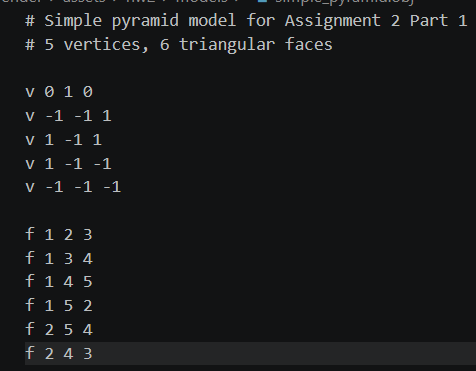
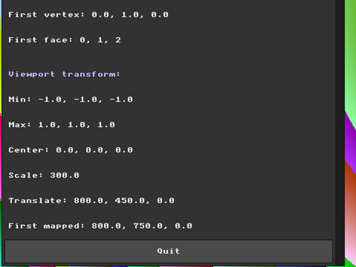

# Assignment 2 Report: Wireframe Viewer and Geometric Transformations

**Name:** Hala Ishan  
**Student ID:** 213692296

---

## Part 0: Introduction to GLM

In this part, I integrated GLM into the project and verified that it works correctly.

GLM is needed for this assignment because the next parts require 3D vectors, matrices, and transformations such as translation, rotation, and scaling.

I updated the project configuration so that CMake fetches GLM and links it with the application.  
Then I included GLM in `main.cpp` and added a small test to check that GLM vectors and transformation matrices work inside the running project.

For the test, I used a 3D point with the values `(1.0, 2.0, 3.0)` and applied a translation of `+10.0` on the X axis.

The expected result was:

`(11.0, 2.0, 3.0)`

This is correct because only the X coordinate changed, while the Y and Z coordinates stayed the same.

At first, I displayed the result inside the GUI to make the test visible while the program was running.
After continuing to Part 2, I removed the temporary Part 0 GUI display because GLM is now used directly in the mesh normalization code.


After adding GLM, the project compiled and ran successfully, and the correct transformation result appeared in the GUI during the Part 0 check.

### Development Note

While testing Part 0, I also checked the mouse input alignment after changing the window size and UI layout.

The old Y-axis offsets that were used before were no longer needed, so I removed that calibration code.

After this change, the mouse position matched the UI controls correctly.

During this check, I also noticed a few possible UI improvements from the previous assignment, such as improving window behavior and making some controls more context-aware.

I decided to keep Part 0 focused on the GLM setup and return to these UI improvements later before continuing with the next parts.

---

## Part 1: Loading and Inspecting 3D Data

In this part, I loaded a simple `.obj` mesh file and stored its data in memory.

I created a small square pyramid test model called `simple_pyramid.obj` with 5 vertices and 6 triangular faces.

I used a square pyramid model because it is small and easy to verify manually. It has 5 vertices and 6 triangular faces, so it is suitable for checking that the OBJ loader reads the correct number of vertices and faces.



In `main.cpp`, I added a `Mesh` structure to store the list of vertices and faces.
Each vertex is stored as a `glm::vec3`, and each face stores three vertex indices.

The OBJ loader reads the file line by line.
Lines that start with `v` are stored as vertices, and lines that start with `f` are stored as faces.

OBJ files use 1-based indices, while C++ vectors use 0-based indices, so I subtract 1 from each face index before storing it.

To check the loader, I displayed the result in the GUI.


The GUI shows that the file was loaded successfully with 5 vertices and 6 faces, which matches the content of the `.obj` file.

The first face appears as `0, 1, 2` because the original OBJ face `1, 2, 3` was converted to C++ vector indexing.

---

## Code Organization Note

After finishing Part 1, I went back to review the code based on the code session comments and the teacher's suggestion to use the DRY principle.

I reorganized the code without changing its behavior. I removed old unused demo/debug code, grouped related variables together, and moved repeated UI code into helper functions.

I also made the code easier to continue by keeping repeated values, such as window titles, UI colors, default window positions, and OBJ paths, in one place.

After the cleanup, I checked that the project still compiles and that the OBJ loading and viewport transform information still display correctly.

---

## Part 2: Normalization and the Viewport Transform

In this part, I added a temporary viewport transform for the loaded mesh.

The goal is to make the mesh fit nicely inside the framebuffer, even if the original `.obj` coordinates are very small, very large, or not centered.

First, I calculate the bounding box of the mesh by finding the minimum and maximum `x`, `y`, and `z` values of all vertices.

Then I calculate the center of the mesh:

```text
center = (min + max) / 2
```

I also calculate the size of the bounding box and choose the largest dimension:

```text
size = max - min
max_extent = max(size.x, size.y, size.z)
```

I use one uniform scale value for all axes so the mesh keeps its original proportions and does not stretch.

```text
scale = 600 / max_extent
```

After that, I calculate a translation vector that moves the scaled mesh to the center of the framebuffer:

```text
translation = framebuffer_center - center * scale
```

The final mapping is:

```text
mapped_position = original_position * scale + translation
```

I displayed the bounding box values, center, scale, translation, and the first mapped vertex in the GUI to check that the calculation works correctly.

This does not draw the mesh yet. It only prepares the normalized screen coordinates that will be used later for the wireframe rendering.

The following screenshot shows the calculated viewport transform values in the GUI:



For the square pyramid model, the bounding box is from `-1` to `1` on each axis. This gives a center of `(0, 0, 0)`, a scale of `300`, and a translation of `(800, 450, 0)`, which places the normalized model around the center of the framebuffer.

---

## Prework Before Part 3

Before starting the wireframe rendering step, I prepared the display area so the mesh will be easier to see.
I added a plain gray background as the default mode, because a wireframe will be clearer on a simple background than on the colorful animated pattern.
The darker inverted shade is enabled by default because it shows both light and dark drawing colors clearly, and pressing `I` toggles back to the lighter gray shade.

The `P` key now cycles between the available background modes in this order:

```text
Plain -> Circles -> Checkerboard
```

When the background is plain, the extra background controls are hidden because there is no tile size, color intensity, or animation to adjust.
When the background is changed to circles or checkerboard, the relevant slider and animation checkbox appear again.
