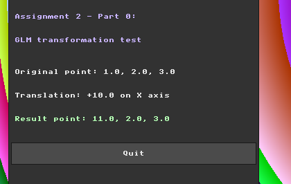
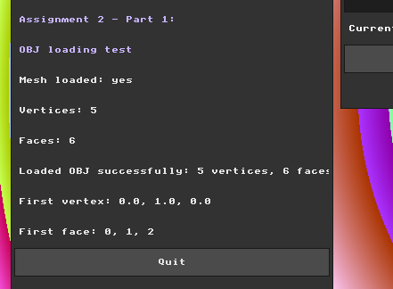

# Assignment 2 Report: Wireframe Viewer and Geometric Transformations

**Name:** Hala Ishan  
**Student ID:** 213692296

---

## Part 0: Introduction to GLM

In this part, I integrated GLM into the project and verified that it works correctly.

GLM is needed for this assignment because the next parts require 3D vectors, matrices, and transformations such as translation, rotation, and scaling.

I updated the project configuration so that CMake fetches GLM and links it with the application.  
Then I included GLM in `main.cpp` and added a small test to check that GLM vectors and transformation matrices work inside the running project.

For the test, I used a 3D point with the values `(1.0, 2.0, 3.0)` and applied a translation of `+10.0` on the X axis.

The expected result was:

`(11.0, 2.0, 3.0)`

This is correct because only the X coordinate changed, while the Y and Z coordinates stayed the same.

I displayed the result inside the GUI to make the test visible while the program is running.

After adding GLM, the project compiled and ran successfully, and the correct transformation result appeared in the GUI.

### Development Note

While testing Part 0, I also checked the mouse input alignment after changing the window size and UI layout.

The old Y-axis offsets that were used before were no longer needed, so I set them back to `0`.

After this change, the mouse position matched the UI controls correctly.

During this check, I also noticed a few possible UI improvements from the previous assignment, such as improving window behavior and making some controls more context-aware.

I decided to keep Part 0 focused on the GLM setup and return to these UI improvements later before continuing with the next parts.

---

## Part 1: Loading and Inspecting 3D Data

In this part, I loaded a simple `.obj` mesh file and stored its data in memory.

I created a small test model called `simple_pyramid.obj` with 5 vertices and 6 triangular faces.

In `main.cpp`, I added a `Mesh` structure to store the list of vertices and faces.
Each vertex is stored as a `glm::vec3`, and each face stores three vertex indices.

The OBJ loader reads the file line by line.
Lines that start with `v` are stored as vertices, and lines that start with `f` are stored as faces.

OBJ files use 1-based indices, while C++ vectors use 0-based indices, so I subtract 1 from each face index before storing it.

To check the loader, I displayed the result in the GUI.

The GUI shows that the file was loaded successfully with 5 vertices and 6 faces, which matches the content of the `.obj` file.

The first face appears as `0, 1, 2` because the original OBJ face `1, 2, 3` was converted to C++ vector indexing.

---

## Code Organization Note

After finishing Part 1, I went back to review the code based on the code session comments and the teacher’s suggestion to use the DRY principle.

I reorganized the code without changing its behavior. I removed old unused demo/debug code, grouped related variables together, and moved repeated UI code into helper functions.

I also made the code easier to continue by keeping repeated values, such as window titles, UI colors, default window positions, and OBJ paths, in one place.

After the cleanup, I checked that the project still compiles and that both the GLM test and OBJ loading test still work correctly.