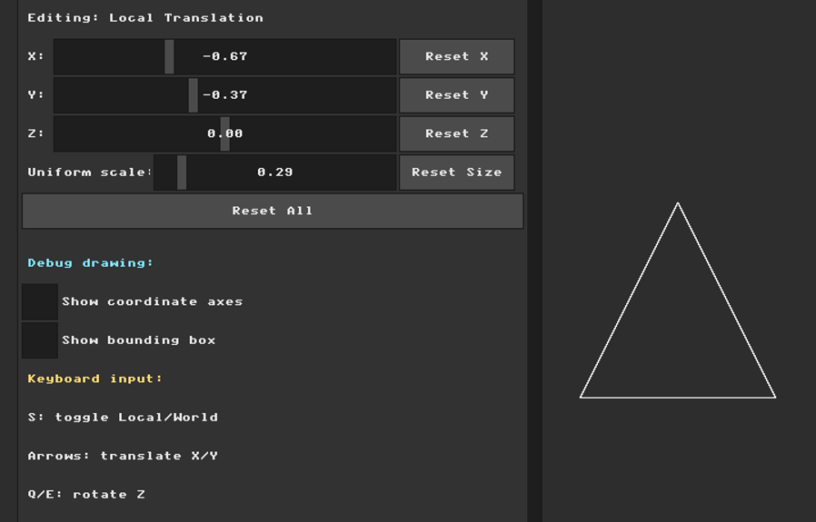
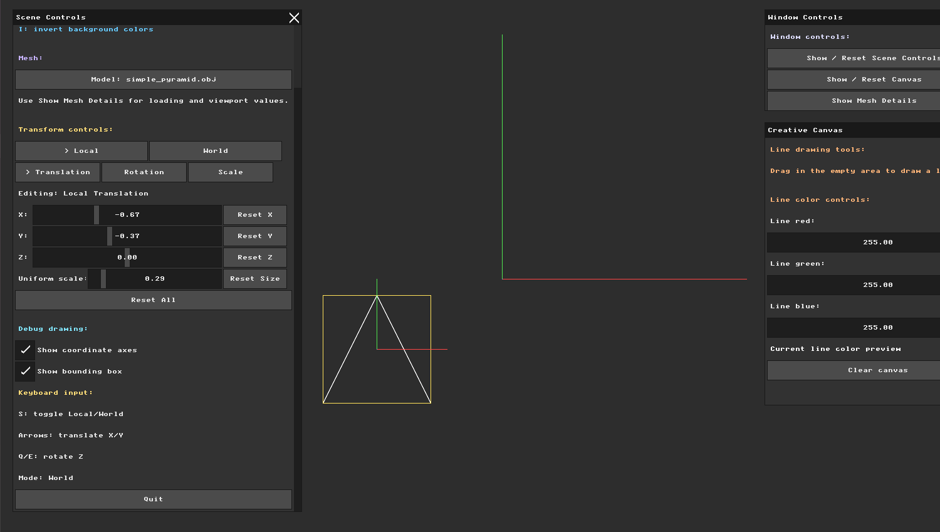
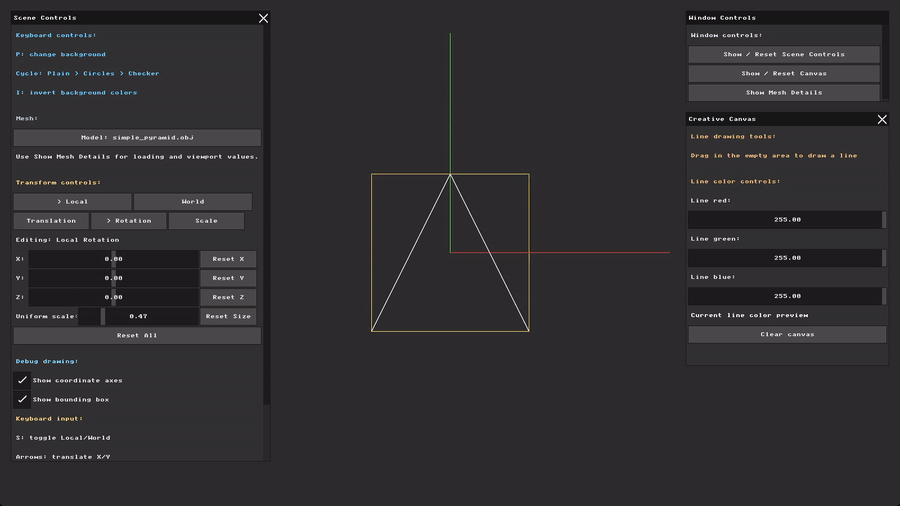
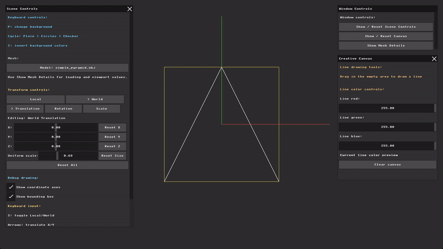
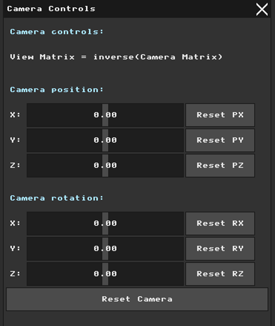
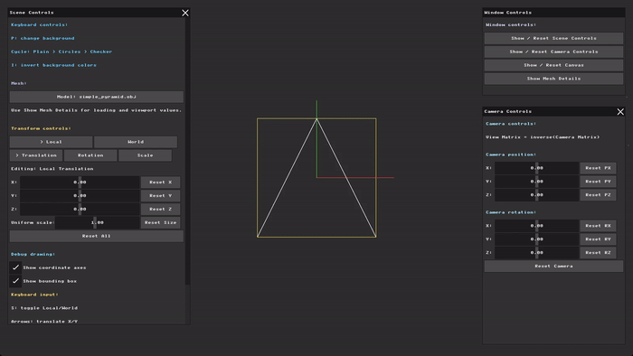
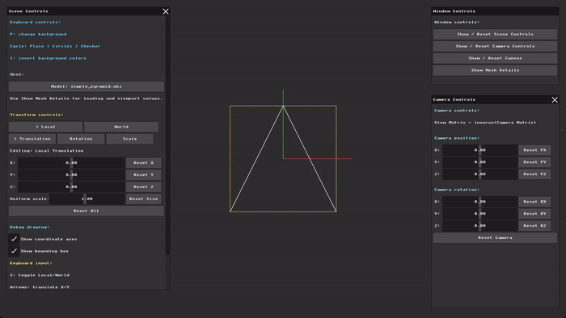

# Assignment 3 Report: Virtual Cameras and Projections

**Name:** Hala Ishan  
**Student ID:** 213692296

---
## Shared Model Assets

In Assignment 2, the OBJ test models were originally placed inside `nanorender/assets/hw2/models/` because they were created for that assignment.  
When starting Assignment 3, I noticed that the same models would be reused in later parts and assignments, so I moved the reusable OBJ files to the shared folder `nanorender/assets/models/`.  
I also updated the renderer's `MESH_OPTIONS` list to load models from this shared folder.

## Part 1: Coordinate Frames and Bounding Boxes

For this part, I added two visual debugging helpers: coordinate axes and a 3D bounding box. Both can be enabled or disabled from the `Debug drawing` section.

**1- Coordinate Axes:**
I draw one fixed set of world axes from `(0, 0, 0)` and one local set from the mesh center.  
The axis colors are red for X, green for Y, and blue for Z.

**2- Bounding Box:**
I use the mesh minimum and maximum values to build the 8 bounding-box corners, then draw the 12 box edges as 3D lines.  
I used the pyramid for the visual test because its shape does not already match a box. With the regular cube, the bounding box overlaps the cube almost exactly, so the bounding-box helper is harder to see.

### The implementation can be seen in the UI and in the rendered scene:
The first image shows the `Debug drawing` checkboxes used to show or hide the coordinate axes and bounding box. The second image shows the result on the pyramid model, where the colored axes and yellow bounding box are visible. Together, the images show that both helpers can be controlled from the UI and displayed on the model.

&nbsp;&nbsp;&nbsp;&nbsp;&nbsp;&nbsp;

### Transform Tests

After enabling both debug helpers, I tested them while transforming the pyramid. I used one local rotation test and one world translation test because they show the two main ideas from the assignment: the local helpers stay attached to the model, while the world axes stay fixed as a reference.

<table>
  <tr>
    <th>Local Rotation Test</th>
    <th>World Translation Test</th>
  </tr>
  <tr>
    <td></td>
    <td></td>
  </tr>
  <tr>
    <td>
      I used <code>Local &gt; Rotation</code> and rotated the pyramid. The model, its local axes, and the yellow bounding box rotate together around the model. This happens because the local axes and bounding box use the same model matrix as the mesh.
    </td>
    <td>
      I used <code>World &gt; Translation</code> and moved the pyramid through the scene. The model, local axes, and bounding box move together, while the world axes remain fixed at <code>(0, 0, 0)</code>. This shows the world frame acting as a stable reference.
    </td>
  </tr>
</table>

---
## Part 2: The Virtual Camera (View Matrix)

### UI Preparation for Camera Work

Before starting the View Matrix implementation, I prepared the interface for camera testing:

- I reduced the default screen fitting size for loaded models to about half of the previous size. In earlier tests, I often had to manually lower the uniform scale before recording examples so there was enough room to see the model movement clearly. With this change, the model appears smaller by default, leaving more visible space for the upcoming View Matrix tests, while the original OBJ vertex data stays unchanged.
- I kept the `Creative Canvas` hidden by default because it is not needed for the camera parts, but it can still be opened from `Window Controls`.
- I added a separate `Camera Controls` panel on the right side of the window for the camera position and rotation sliders.
- I changed the default model to `simple_pyramid.obj` for this part because its shape makes the camera movement and rotation easier to see while testing.

### View Matrix Implementation

For Part 2, I added a `Camera Controls` panel with X, Y, and Z sliders for camera position and rotation, plus reset buttons for each axis and for the full camera.

I build the camera matrix from translation and rotation, then use its inverse as the View Matrix:

`Camera Matrix = Translation * Rotation` 
`View Matrix = inverse(Camera Matrix)`

During rendering, the original OBJ vertices stay unchanged and are transformed temporarily each frame:

`vertex -> Model Matrix -> View Matrix -> viewport transform -> orthographic projection`

Because the View Matrix is the inverse camera transform, moving or rotating the camera makes the scene appear to move or rotate in the opposite direction.

### Camera Movement Tests

To isolate the camera effect, I started both tests from the normal model position: one test changes camera position, and the other changes camera rotation.

<table>
  <tr>
    <th>Camera Position X/Y</th>
    <th>Camera Rotation X/Y</th>
  </tr>
  <tr>
    <td></td>
    <td></td>
  </tr>
  <tr>
    <td>
      I moved the camera left on X, so the object appeared to move right. Then I moved the camera up on Y, so the object appeared to move down. This confirms the inverse movement caused by the View Matrix.
    </td>
    <td>
      I rotated the camera with a negative X rotation and a positive Y rotation. The mesh, axes, and bounding box changed view together because they all pass through the same View Matrix before projection.
    </td>
  </tr>
</table>

---

