# Assignment 4 Report

**Name:** Hala Ishan
**Student ID:** 213692296

---
## Part 1: Bounding Box Rasterization

For this part, I added a debug rasterization mode for triangle bounding boxes. Instead of drawing the triangle wireframe edges, I project the triangle to screen space, calculate the smallest 2D rectangle around it, and fill that rectangle directly in `g_buffer`.

To implement this, I used the same projection path from the renderer. For each face, I projected its three vertices to screen coordinates and used `min x`, `max x`, `min y`, and `max y` to define the rectangle. After that, I looped over the pixels inside the rectangle and wrote the triangle color directly to `g_buffer`.

Each triangle bounding box gets a different solid color. This is why the result looks like overlapping colored rectangles instead of filled triangles. This is expected for Part 1 because the goal is only to show the bounding box step before doing the inside-triangle test in the next part.

I added a UI toggle called `Show triangle boxes` so this debug view can be turned on and off without removing the old wireframe renderer.

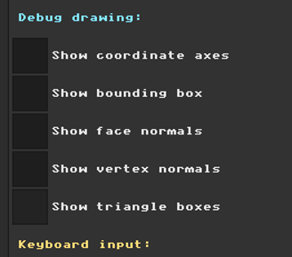

### Bounding Box Rasterization Results

The examples below show the debug view on the three different models. In each example, the model is drawn as overlapping colored rectangles. This shows that the renderer is calculating a screen-space bounding box for each projected triangle and drawing it to the framebuffer.

<table>
  <tr>
    <th>Pyramid</th>
    <th>Regular Cube</th>
    <th>Angled Box</th>
  </tr>
  <tr>
    <td>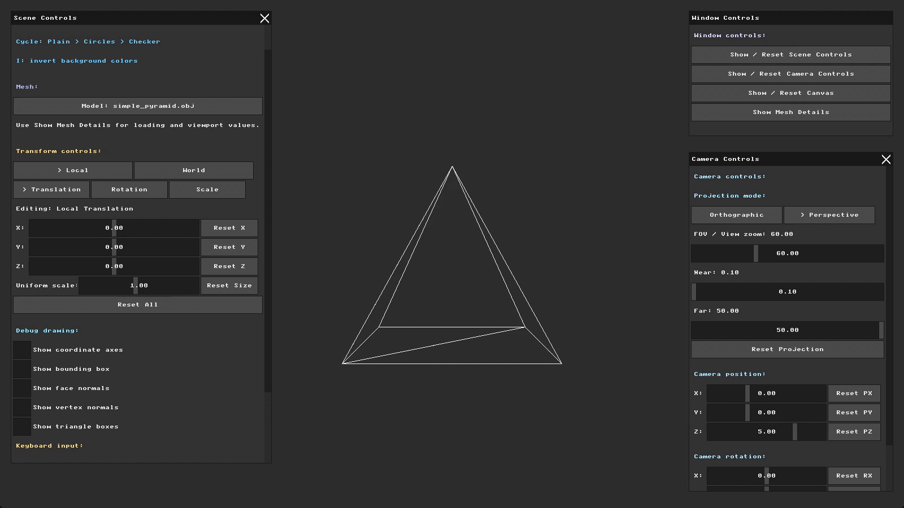</td>
    <td>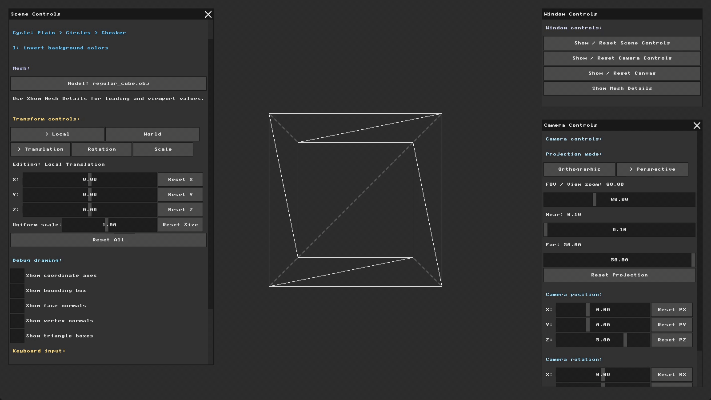</td>
    <td>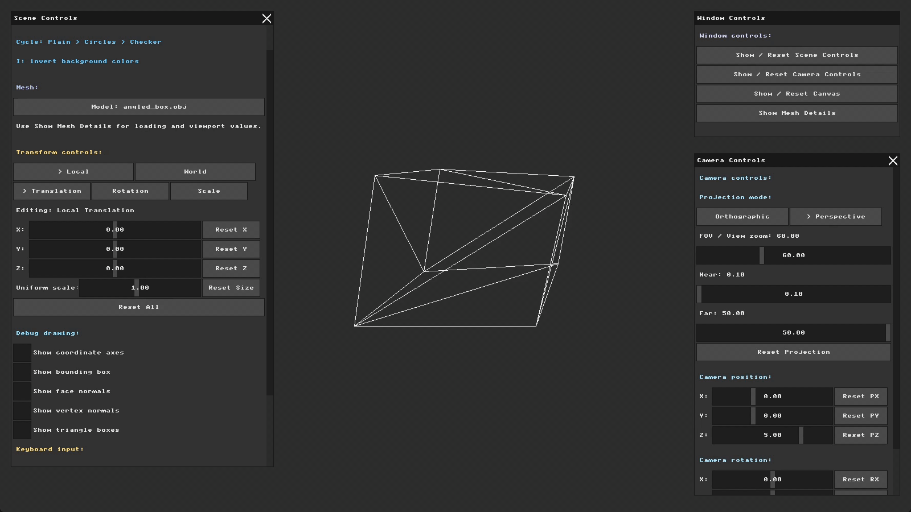</td>
  </tr>
  <tr>
    <td>
      The pyramid shows large overlapping boxes because each triangle face has its own screen rectangle.
    </td>
    <td>
      The cube shows that the boxes still follow the projected faces when the model rotates.
    </td>
    <td>
      The angled box makes the different projected triangle rectangles easy to see.
    </td>
  </tr>
</table>

### Toggle Comparison

I also recorded the regular cube rotating around the Y axis from `-180` to `180`. The first GIF shows the normal wireframe view with the debug mode off. The second GIF shows the same rotation with `Show triangle boxes` enabled, where the cube is represented by the colored bounding rectangles instead of triangle edges.

<table>
  <tr>
    <th>Debug View Off</th>
    <th>Debug View On</th>
  </tr>
  <tr>
    <td>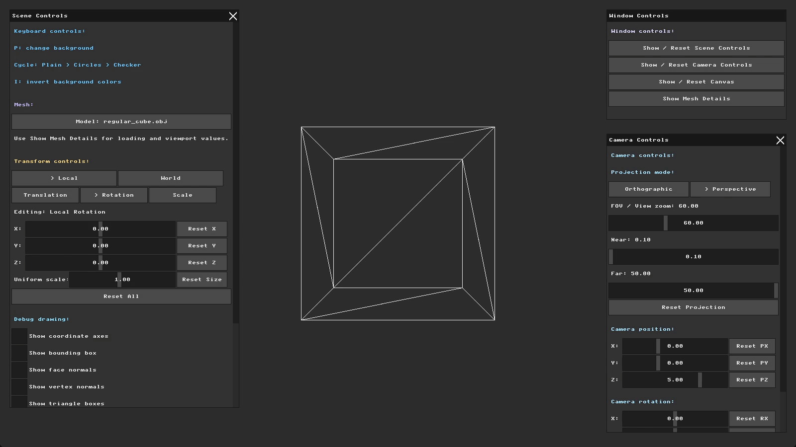</td>
    <td>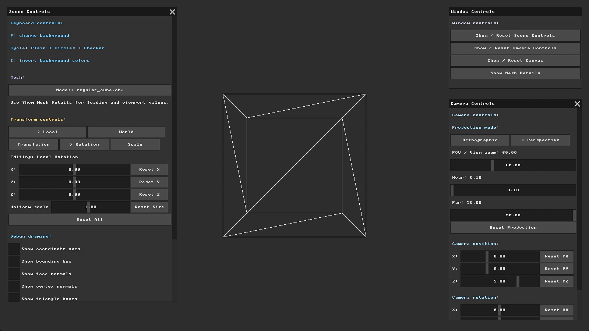</td>
  </tr>
  <tr>
    <td>
      With the debug view off, the cube keeps the old wireframe rendering behavior.
    </td>
    <td>
      With the debug view on, each projected triangle is shown as its filled 2D bounding rectangle.
    </td>
  </tr>
</table>

---
## Part 2: Triangle Filling Algorithms

For this part, I updated the Part 1 loop. Instead of coloring the whole bounding box, I use barycentric coordinates to color only the pixels inside the triangle.

I kept the bounding box loop, but changed the inside step. The bounding box is still useful because it limits the pixels I need to check. I do not check the whole screen, only the pixels inside the triangle rectangle. For each pixel, I calculate `alpha`, `beta`, and `gamma`. These values tell me if the pixel is inside the triangle.

The main loop became:

```text
for each pixel inside the triangle bounding box:
    calculate alpha, beta, gamma
    if alpha, beta, and gamma are all between 0 and 1:
        draw the pixel
    otherwise:
        skip it
```

The three values act like weights for the triangle vertices:

`alpha + beta + gamma = 1`

If all three values stay between `0` and `1`, the pixel is inside the triangle. If one value goes outside this range, the pixel is outside and I skip it.

I updated the UI toggle to `Show filled triangles` because this mode now draws the triangle area, not only its bounding rectangle.

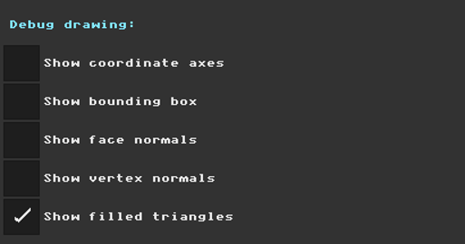

### Filled Triangle Results

The examples below show the filled triangle mode on three models in Perspective mode. Each face has a different color, and the color now stays inside the triangle shape.

<table>
  <tr>
    <th>Pyramid</th>
    <th>Regular Cube</th>
    <th>Angled Box</th>
  </tr>
  <tr>
    <td>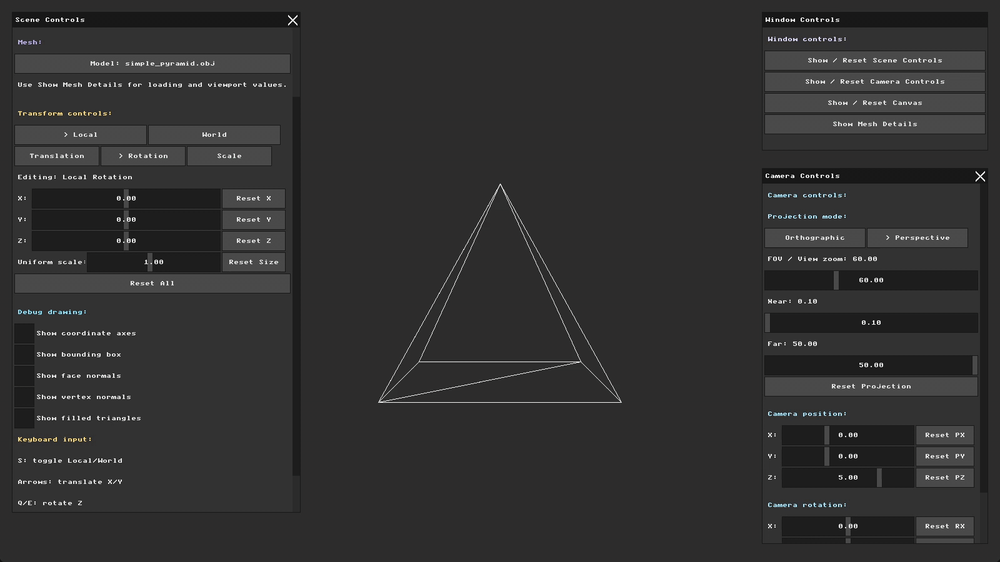</td>
    <td>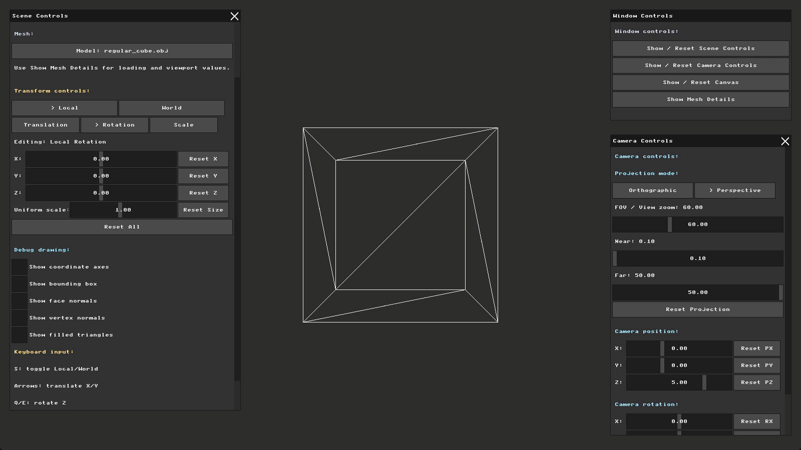</td>
    <td>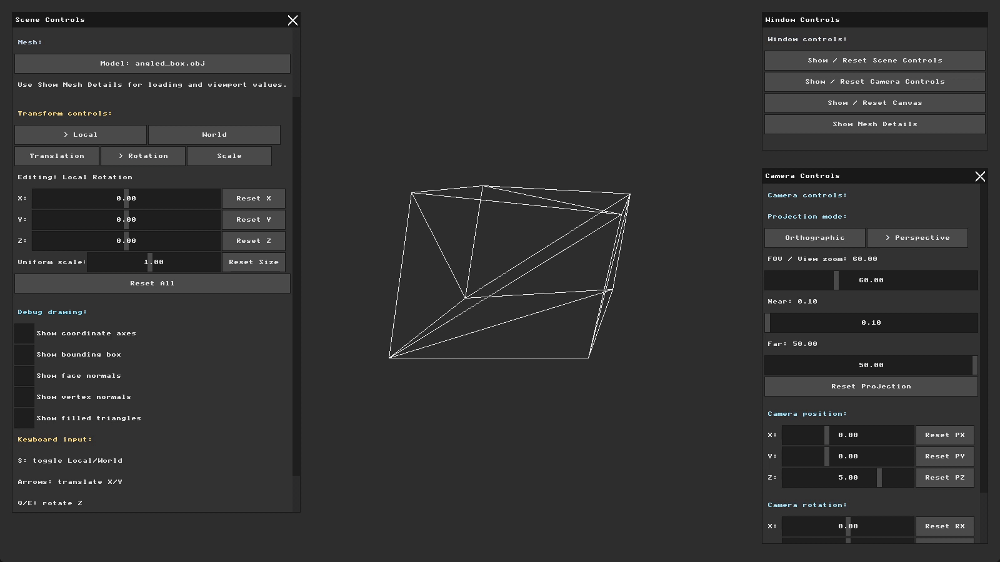</td>
  </tr>
  <tr>
    <td>
      The pyramid shows that the colored regions now match the triangle faces instead of the full bounding rectangles.
    </td>
    <td>
      The cube appears as a solid colored object made from filled triangle faces.
    </td>
    <td>
      The angled box shows the same filling behavior on a shape with less regular screen-space faces.
    </td>
  </tr>
</table>

### Filled and Wireframe Comparison

I recorded the same rotation twice: once as wireframe and once with filled triangles. In both GIFs, I rotated the model on Y from `-180` to `180`, then on X to `180`.

<table>
  <tr>
    <th>Wireframe</th>
    <th>Filled Triangles</th>
  </tr>
  <tr>
    <td>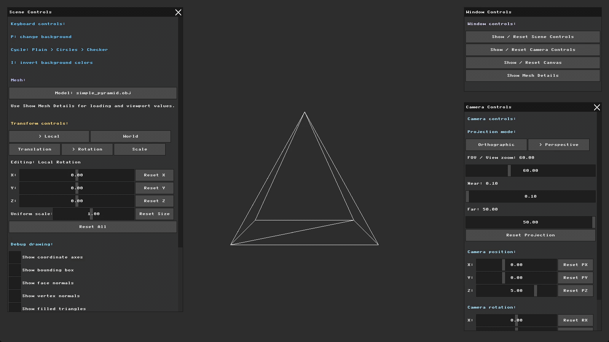</td>
    <td>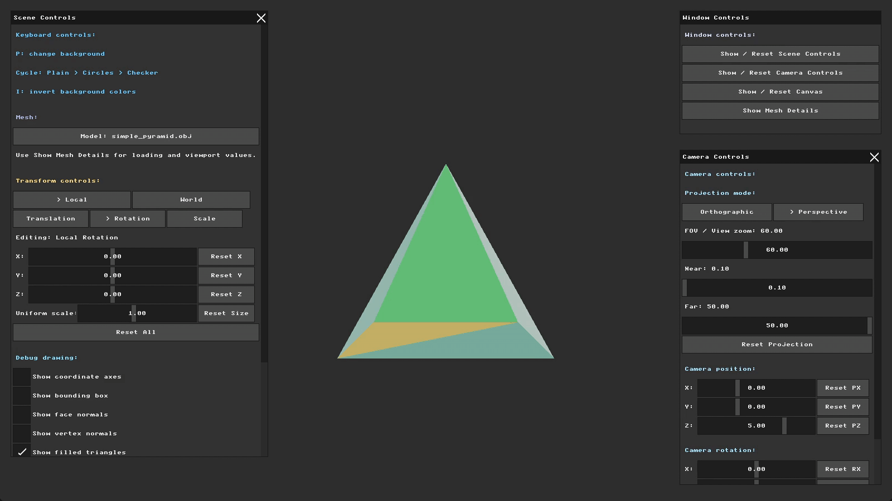</td>
  </tr>
  <tr>
    <td>
      With the mode off, the model is still drawn using the old wireframe rendering.
    </td>
    <td>
      With the mode on, the same projected triangles are filled using the barycentric inside-triangle check.
    </td>
  </tr>
</table>

This comparison makes the change from wireframe edges to filled faces clear. Some faces can still overlap incorrectly because there is no Z-buffer yet. The triangles are drawn in mesh order, so a farther triangle can appear on top of a closer one. This will be fixed in the next part.