# Assignment 5 Report

**Name:** Hala Ishan<br>
**Student ID:** 213692296

---

In this assignment, I started adding lighting to the solid models. In the previous assignment, the models became filled and depth-tested, but the colors were still flat and did not react to light.

Here, I use light properties, material properties, and normals to make the model respond to lighting. I started with ambient lighting, then built on it with diffuse lighting and specular highlights.

---
## Part 1: Light Sources and Material Properties

In Part 1, I set up the basic light and material data. I only used ambient lighting here, so the object changes color but still looks flat.

### Light and Material Data

The task asked for a point light and material properties, so I stored them in two structs: `PointLight` and `Material`.

`PointLight` stores the light position and the ambient, diffuse, and specular light colors.

```cpp
struct PointLight {
  glm::vec3 position;
  glm::vec3 ambient;
  glm::vec3 diffuse;
  glm::vec3 specular;
};
```

The `Material` stores how the object responds to the light. This lets the object keep its own material color instead of using only the light color.

```cpp
struct Material {
  glm::vec3 ambient;
  glm::vec3 diffuse;
  glm::vec3 specular;
};
```

In Part 1, only the `ambient` values affect the rendered image. The `diffuse` and `specular` values are stored for the next lighting parts.

For the actual color in Part 1, I multiply the two ambient colors:

```text
ambient color = light ambient * material ambient
```

This means the final flat color depends on both sides: the light controls the color and strength of the ambient light, and the material controls what color the object reflects.

---

### Light and Material UI

I added a UI panel called `Light and Material` for the Part 1 controls.

<table>
  <tr>
    <td>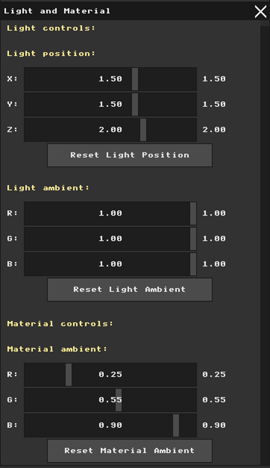</td>
    <td>
      The default setup uses white ambient light and a blue material.<br>
      This makes the result easy to read because the white light keeps the material color clear.
      <br><br>
      The panel includes light position, light ambient color, and material ambient color controls. <br>
      Each color has RGB sliders, and each group has its own reset button.
      <br><br>
      The light position is shown because the assignment requires it, but it does not affect Part 1 yet because ambient lighting does not use light direction.
    </td>
  </tr>
</table>

---

### Ambient Display Toggle

<table>
  <tr>
    <td>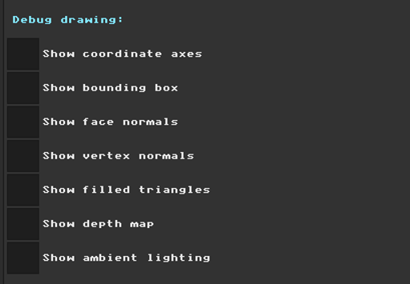</td>
    <td>
      I added `Show ambient lighting` to display the ambient result. <br><br>
      This mode still uses the filled triangle rasterizer and Z-buffer from Assignment 4, but replaces the random face colors with the ambient lighting color.<br>
      Since only ambient lighting is active, the object changes color but does not have bright or dark sides yet.
    </td>
  </tr>
</table>

---

### Examples

I used two examples because the ambient equation has two sides: the material color and the light color.

#### Material Ambient Example

In this example, I tested the material side of the ambient equation. The ambient light stayed white, so the changes mostly show how the material color affects the object.

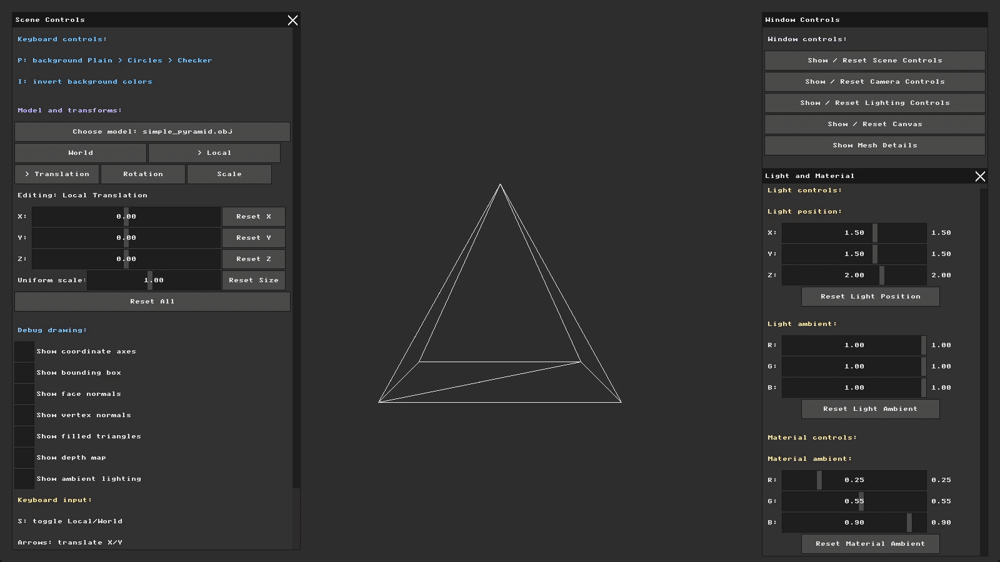

<table>
  <tr>
    <th>Action</th>
    <th>What happened</th>
    <th>Why it happened</th>
  </tr>
  <tr>
    <td>Started from the default material</td>
    <td>The object appeared blue.</td>
    <td>The white ambient light kept the blue material color clear.</td>
  </tr>
  <tr>
    <td>Increased the first RGB slider (red)</td>
    <td>The object became less pure blue and moved toward a more purple color.</td>
    <td>Adding more red to the material means the object reflects more red under the same white light.</td>
  </tr>
  <tr>
    <td>Reset material ambient</td>
    <td>The object returned to the default blue color.</td>
    <td>The values returned to the default material color.</td>
  </tr>
  <tr>
    <td>Decreased the second RGB slider (green)</td>
    <td>The object became a deeper blue.</td>
    <td>Reducing green removes part of the cyan/bright component, so the final color becomes darker and more blue-dominant.</td>
  </tr>
</table>

#### Light Ambient Example

In this example, I kept the material color fixed and changed the light ambient color. This checks the light side of the equation.

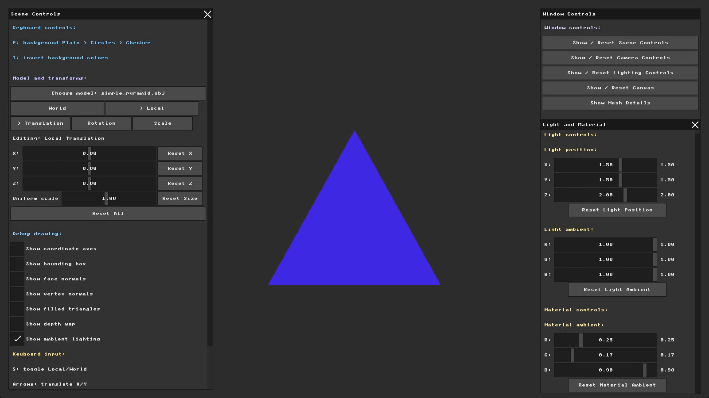

<table>
  <tr>
    <th>Action</th>
    <th>What happened</th>
    <th>Why it happened</th>
  </tr>
  <tr>
    <td>Started with the material color from the previous example</td>
    <td>The object kept the darker blue material result.</td>
    <td>The material side stayed fixed, so the next changes come from the light side.</td>
  </tr>
  <tr>
    <td>Decreased the first RGB slider (red)</td>
    <td>The red contribution became weaker.</td>
    <td>The light ambient color multiplies the material color, so reducing red light reduces the red part of the final color.</td>
  </tr>
  <tr>
    <td>Decreased the second RGB slider (green)</td>
    <td>The object became darker overall.</td>
    <td>Now both red and green light channels are weaker, so fewer color components remain strong in the final result.</td>
  </tr>
  <tr>
    <td>Reset light ambient</td>
    <td>The object returned to the clearer default result.</td>
    <td>The light returned to white.</td>
  </tr>
  <tr>
    <td>Decreased the third RGB slider (blue)</td>
    <td>The blue became weaker, and the object shifted toward a dark lilac color.</td>
    <td>Since the material was blue-heavy, reducing the blue light channel strongly changed the final color.</td>
  </tr>
</table>


Together, these examples helped me check both sides of the ambient equation. The material controls what color the object can reflect, and the light controls how strongly the color appears. The model stays flat here because diffuse and specular lighting are added later.

---

## Render Mode Organization

As I added more render results, the separate checkboxes became harder to organize, so I replaced the main render options with one `Render mode` selector.

Before this change, the renderer already made sure that only one main render view could be active at a time, which was correct. But after adding more views, the separate options became less clear. The selector keeps the same behavior in a cleaner way because I choose one main result at a time. At first it included `Wireframe`, `Filled triangles`, `Depth map`, and `Ambient lighting`. Later parts added `Flat shading` and `Specular highlights` to the same selector.

The debug drawings, such as axes, bounding box, and normals, stayed as checkboxes because they are overlays that can appear on top of the selected render mode.

The image shows the selector UI, and the GIF shows that only one main render mode is active at a time.

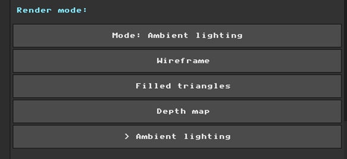&nbsp;&nbsp;&nbsp;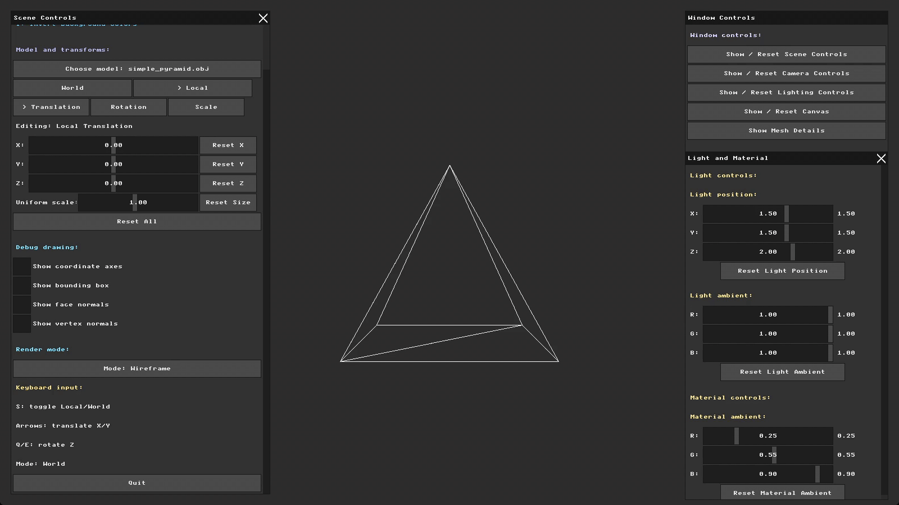

---

## Part 2: Flat Shading (Diffuse Lighting)

In Part 2, I added diffuse lighting using flat shading. This was the first part where the light direction changed the brightness of the model. The renderer now has a `Flat shading` render mode that still uses the filled triangle rasterizer and Z-buffer from Assignment 4.

For each triangle, I calculate the lighting once using the face normal and triangle center. The same color is then used for all pixels inside that triangle. Because of this, each face looks flat, and the whole model looks faceted.

```text
diffuse strength = max(dot(face normal, light direction), 0)
final color = ambient + diffuse
```

The diffuse part is calculated from the light diffuse color, the material diffuse color, and the diffuse strength:

```text
diffuse = light diffuse * material diffuse * diffuse strength
```

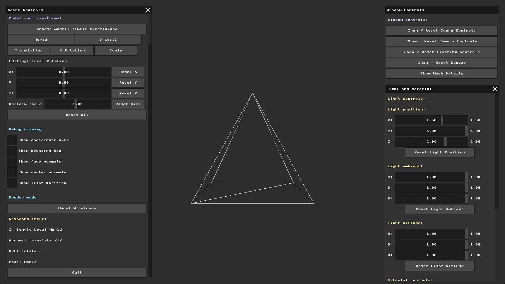

The GIF shows the model in `Flat shading` mode. When I rotate the model, each face keeps one flat color, but the brightness changes from face to face. This shows that the face normal and light direction are being used.

---

### Light Position Helper

Before testing diffuse lighting, I needed a way to understand where the light is coming from. The light is stored as a point in world space. For each triangle, I calculate the light direction from the triangle center toward the light position:

```text
light direction = light position - triangle center
```

To make the light position easier to see, I added a debug checkbox called `Show light position`, so I can turn the helper on only when I need it. It draws a small yellow marker at the point light position and a line from the light toward the model center. This helper is only for visualization; the diffuse calculation still uses each triangle center.

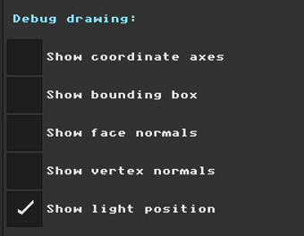&nbsp;&nbsp;&nbsp;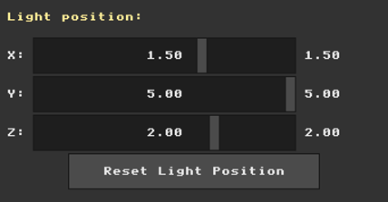

The screenshot shows the light position controls. In the example, I moved the Y value toward the positive side, while X and Z stayed at their default values. This makes the light come more from one vertical side of the model, so it is easier to see the lighting direction change.

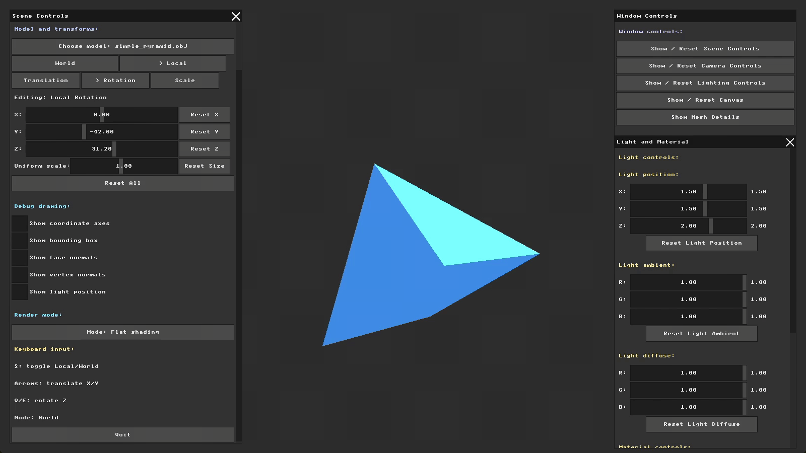

In this example, I moved the light position on the Y axis while showing the light helper. Faces facing the light become brighter, while other faces become darker. This shows that the diffuse value depends on the angle between the face normal and the light direction. I did not add distance attenuation yet, so the important change here is direction, not distance.

---

### Light Diffuse Color

The `Light diffuse` controls the color and strength of the diffuse light. Its default value is white, `(1, 1, 1)`, meaning full red, green, and blue intensity. This keeps the material color clear before testing the sliders.

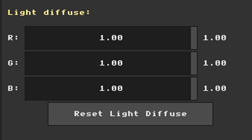
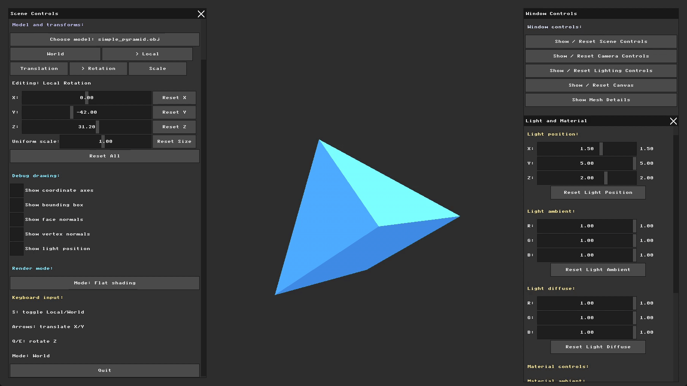

In this example, I first tried changing the blue diffuse value, but the change was hard to see because the ambient blue color was still strong. To make the diffuse effect clearer, I lowered the blue ambient value, then changed the blue diffuse value again. After that, the lit faces changed more clearly. This showed me that `Light diffuse` was working, but a strong ambient color can hide small diffuse changes. After reset, the light returns to the default white diffuse color.

---

### Material Diffuse Color

The `Material diffuse` controls what diffuse color the object reflects. Its default matches the blue material color from Part 1, `(0.25, 0.55, 0.90)`. Since the material is blue-heavy, changing the blue or red channel makes the effect easier to notice.

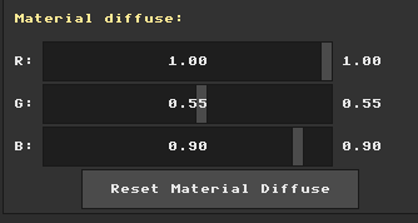
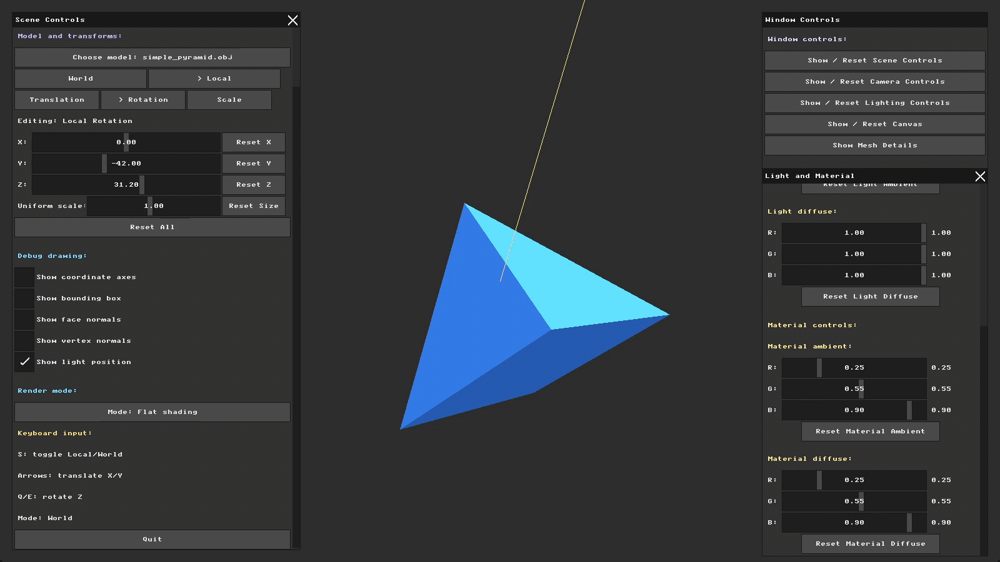

In this example, I changed the material diffuse channels. Lowering the blue value made the diffuse part less blue, and changing the red value changed how much red the material could reflect in the lit faces. Resetting `Material diffuse` returns the material to the default blue diffuse color.

These examples show that Part 2 adds direction-based diffuse lighting. I could see that faces facing the light became brighter, while other faces became darker. Ambient still gives the base color, and diffuse adds the face brightness based on the light direction. At this stage, specular lighting was still not included; it is added in Part 3.

---

## Part 3: Specular Highlights

In Part 3, I added specular highlights to the lighting model. This is the shiny part of the color, so now the result is not only a base color from ambient lighting or face brightness from diffuse lighting.

Before this part, the model had a base color from ambient lighting and face brightness from diffuse lighting. Specular adds the shiny part on top of them:

```text
final color = ambient + diffuse + specular
```

For each triangle, I still use the same face normal and triangle center from flat shading. From that center point, I calculate the direction toward the light and the direction toward the camera. Then I use the face normal to calculate the reflection vector:

```text
reflection vector = reflect(-light direction, face normal)
specular strength = pow(max(dot(reflection vector, view direction), 0), shininess)
```

The important thing I noticed is that specular can disappear easily. It depends on the light direction, the face normal, and the camera direction together. If the reflection vector is not close to the view direction, the highlight becomes very weak or almost invisible.

The `shininess` value controls the shape of the highlight. A low value makes the highlight wider and easier to see. A high value makes it smaller and sharper.

I added a new render mode called `Specular highlights`. This mode still uses the triangle filling and Z-buffer from Assignment 4, but the color now includes ambient, diffuse, and specular lighting together.

---

### Specular Controls

I added these controls so I could test the shiny part directly from the UI:

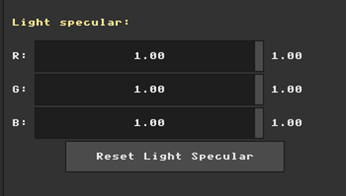&nbsp;&nbsp;&nbsp;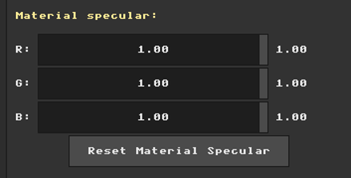&nbsp;&nbsp;&nbsp;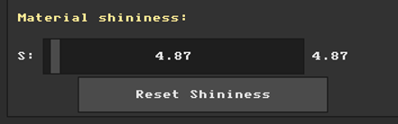

The new controls are `Light specular`, `Material specular`, and `Material shininess`. They match the specular color equation:

```text
specular color = light specular * material specular * specular strength
```

`Light specular` controls the color and strength of the shiny light. `Material specular` controls how much of that shiny light the object reflects. `Material shininess` controls whether the highlight is wide or concentrated.

At first, the slider changes were not clear in the result. To make the highlight easier to see, I lowered the ambient light, used medium diffuse light, kept the specular values strong, and lowered the shininess value. I also rotated the pyramid on X and Y so more than one face was visible.

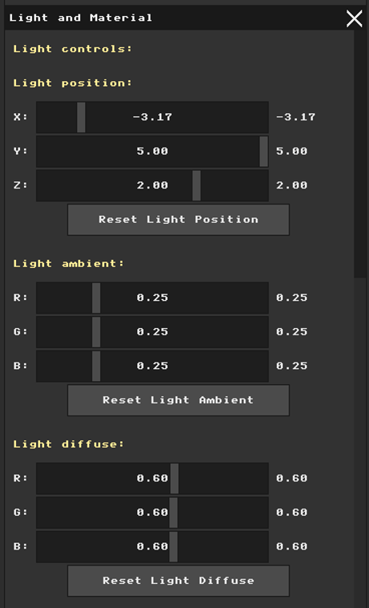

With this setup, the shiny part became easier to separate from the normal face color.

---

### Specular Highlights Mode

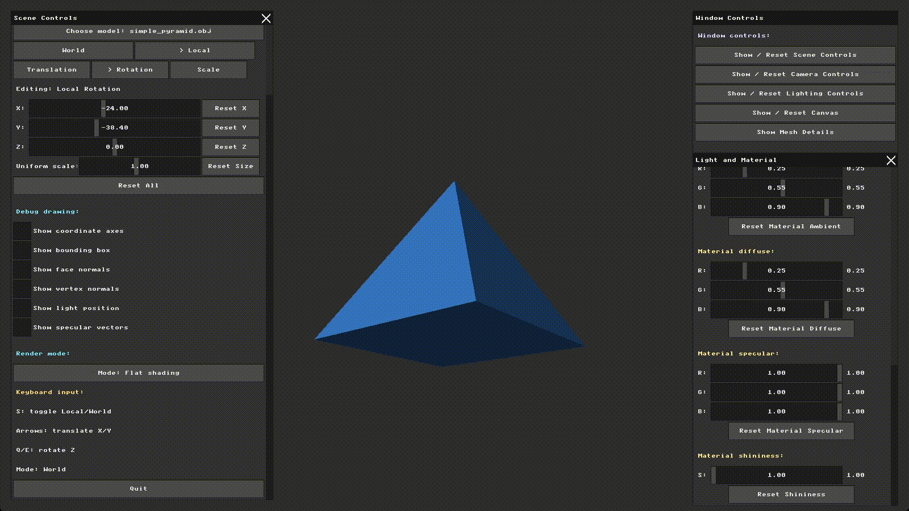

I rotated the pyramid so more faces were visible, then started recording this example. In the video, I switched to `Specular highlights` mode. I used a very low shininess value here because it makes the highlight wide and clear for the first check.

This was my first visual check that Part 3 was active. The object still has ambient and diffuse lighting, but now a shiny highlight is added to the final color.

---

### Shininess Example


In this example, I tested the `shininess` value. I started from the default value, then increased it to a high value. The change was not very visible because the highlight became too small. When I lowered shininess, the highlight became wider and easier to notice.

This helped me understand what the exponent does in the specular equation: a high value keeps the bright area small, while a low value spreads it over a larger area.

---

### Light Specular Example

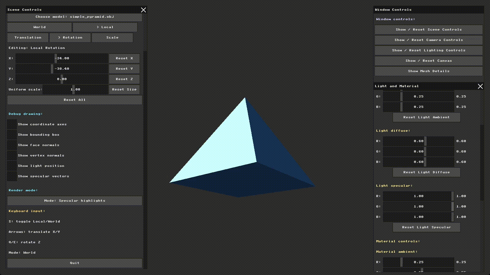

In this example, I tested the color side of the specular light. I started with white specular light, then lowered the blue, green, and red channels one by one. As each channel became weaker, the highlight color shifted toward the remaining channels. At the end, I reset the light specular values back to white.

This checks the light side of the specular equation. `Material specular` uses the same multiplication idea, but I did not include a separate GIF for it because the `Light specular` change was clearer in this setup.

---

### Specular Vector Debug

For the required vector check, I added `Show specular vectors`. The assignment asks to draw the incoming light vector and the outgoing reflection vector from the center of a few faces.

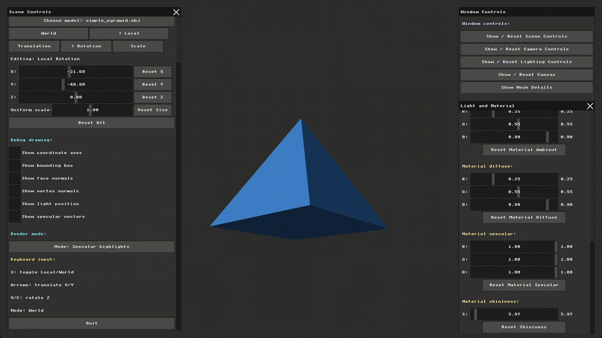

In this debug view, I turned on `Show specular vectors` with the light position helper. The red line starts from the face center and points toward the light, so it shows the light direction used for that triangle. The black line shows the reflection direction after the light vector is reflected around the face normal.

I draw the vectors from the face centers because the specular calculation in this part is done once per triangle, the same as flat shading. When I rotated the model, the vectors changed with the faces because the face centers and normals changed. This helped me check that the reflection direction used for the highlight is connected to the triangle normal and the light direction.

From these examples, I could see that specular lighting depends on the light direction, face normal, camera direction, and shininess value. The highlight became clear only when these values were set in a way that made the reflection direction visible from the camera.
